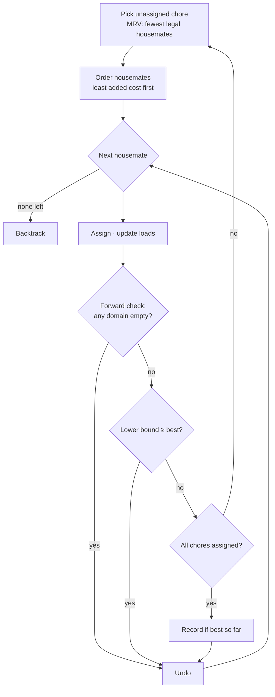
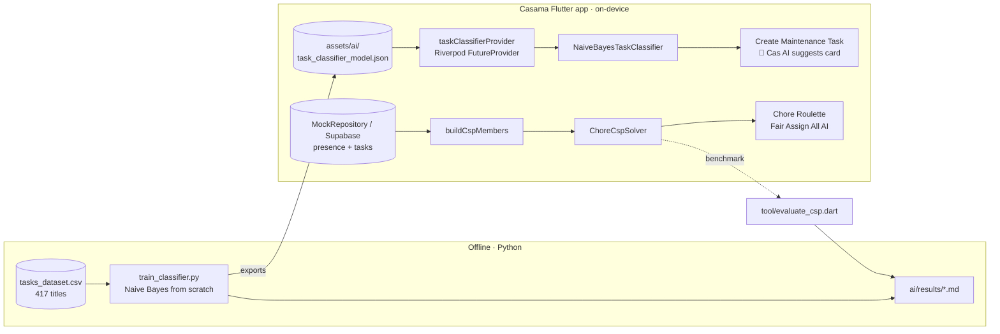

# Casama AI 🦉🧠

> **AI Final Project** — integrating Artificial Intelligence algorithms into **Casama**, a shared-living coordination app (3rd-year Application Development final project, Flutter + Supabase).

This repository adds two AI algorithms to the Casama app:

| # | Algorithm | AI family | Where it lives in the app | What it does |
|---|---|---|---|---|
| 1 | **Multinomial Naive Bayes** text classifier | Machine learning / probabilistic reasoning | *Maintenance & Restock → Create task* | Reads the task title as you type (English, Filipino or Taglish) and suggests the **category** (DIY · Landlord · Restock) and **urgency** (Low · Medium · Urgent). |
| 2 | **Constraint Satisfaction Problem (CSP)** solver: backtracking + MRV + forward checking + branch & bound | Search / constraint reasoning | *Chore Roulette → Fair Assign All (AI)* | Splits the household's chores **fairly**: must-do-now chores go only to people who are home, nobody is overloaded, existing workload is balanced, and chores rotate. |

Both algorithms are written **from scratch** (no ML or solver libraries). They run **on-device** with no internet, API key or server, so they also work in Casama's offline demo mode.

> 📄 The original Casama app documentation (features, setup, APK build) is kept unchanged in **[APP_README.md](APP_README.md)**.

---

## Table of contents

1. [Team](#-team)
2. [Problem & motivation](#-problem--motivation)
3. [Algorithm 1 — Multinomial Naive Bayes](#-algorithm-1--multinomial-naive-bayes-task-classifier)
4. [Algorithm 2 — CSP fair chore assignment](#-algorithm-2--csp-fair-chore-assignment)
5. [Implementation & integration](#-implementation--integration)
6. [How to run (scripts)](#-how-to-run-scripts)
7. [Results](#-results)
8. [Testing & verification](#-testing--verification)
9. [Limitations & future work](#-limitations--future-work)
10. [References](#-references)

---

## 👥 Team

| Role | Name |
|---|---|
| AI Final Project — members | _TODO: add names_ |
| Casama app (3rd-year Application Development) | _TODO: add names_ |
| Subject / Instructor | Artificial Intelligence — _TODO_ |

---

## 🎯 Problem & motivation

Casama already records maintenance tasks and has a Chore Roulette, but two pain points remained:

1. **Creating a task needed three manual decisions.** Users had to type the title and then pick a category and an urgency themselves. The defaults were always *DIY / Medium*, so a "gas leak" was saved as a medium-priority DIY chore unless someone changed it.
   → This is a **text classification** problem: the title already contains the information, so a classifier can read it.
2. **The roulette is random, and random isn't fair.** The original wheel picked a housemate uniformly at random. It could give "Take out the trash *now*" to someone who is out at class, or give the person with the most open tasks even more work.
   → This is an **assignment problem with hard rules and a fairness goal**, which is exactly what a **Constraint Satisfaction Problem** solves.

---

## 📨 Algorithm 1 — Multinomial Naive Bayes task classifier

### Why Naive Bayes?

- Task titles are **short texts** (3–8 words). Naive Bayes is a classic, strong baseline for short-text classification and works well even on small datasets (a few hundred examples).
- **Interpretable.** We can list the words that push a title toward each class (`buy`/`bili`/`ubos` → Restock, `sira`/`landlord`/`broken` → Landlord).
- **Tiny and fast.** The model is a lookup table of log-probabilities (≈200 KB JSON). Inference is a sum of numbers and runs in microseconds on a phone.
- It returns **probabilities**, so the app can tell when it is confident and when it is unsure (see the confidence threshold below).

### How it works

For a title with tokens *w₁…wₙ* and a class *c*, Bayes' rule with the "naive" assumption that words are conditionally independent gives:

```
P(c | w₁…wₙ)  ∝  P(c) · Π P(wᵢ | c)
```

Training counts words per class, with **Laplace (additive) smoothing α** so unseen word/class pairs don't produce zero probabilities:

```
P(c)     = (# titles in class c) / (# titles)
P(w | c) = (count(w, c) + α) / (Σ_w' count(w', c) + α·|V|)
```

Prediction works in **log space**, which avoids floating-point underflow:

```
score(c) = log P(c) + Σ log P(wᵢ | c)
P(c | title) = softmax(score)   ← computed with the log-sum-exp trick
```

**Features (tokenizer):** lowercase → split on non-alphanumeric characters (keeps `ñ`) → remove a small English + Filipino stop-word list (`the, sa, ng, ang, na…`) → add **bigrams** (`leaking_faucet`, `ubos_na`) so short phrases count too. The tokenizer is implemented identically in Python (training) and Dart (app), and a parity test checks that the two match.

We train **two independent classifiers** on the same titles: one for *category*, one for *urgency*.

### Dataset

[`ai/data/tasks_dataset.csv`](ai/data/tasks_dataset.csv) has **417 unique, hand-labelled household task titles**. They are written in the way Filipino dorm and apartment residents actually type: English, Filipino and Taglish (`Leaking faucet sa CR`, `Ubos na ang gasul`, `Sira ang aircon`).

| Label | Classes (count) |
|---|---|
| Category | diy 158 · landlord 139 · restock 120 |
| Urgency | low 174 · medium 139 · urgent 104 |

Labelling guide we followed:
- **landlord**: building, plumbing, electrical, structural, pests, and appliances owned by the landlord, i.e. things tenants should not fix themselves.
- **restock**: buying or refilling consumables (water, LPG, rice, toiletries, load).
- **diy**: cleaning and small fixes housemates do themselves.
- **urgent**: safety hazards, things that block daily life right now, and messes that get worse fast. **medium**: should be done today or tomorrow. **low**: whenever convenient.

> ⚠️ The dataset was written and labelled by the team; it is not scraped from real users. See [Limitations](#-limitations--future-work).

### Training & evaluation protocol

Script: [`ai/naive_bayes/train_classifier.py`](ai/naive_bayes/train_classifier.py) (Python standard library only; fixed seed 42).

1. **Stratified 80/20 split** into train (333) and test (84).
2. **5-fold cross-validation on the training split only** chooses α from {0.1, 0.25, 0.5, 1, 2}.
3. A single evaluation on the untouched **test split** gives accuracy, per-class precision/recall/F1, a confusion matrix, and a **majority-class baseline** for comparison.
4. A **confidence threshold analysis** measures coverage vs. accuracy.
5. The **final model** is re-trained on all 417 titles with the chosen α and exported to [`assets/ai/task_classifier_model.json`](assets/ai/task_classifier_model.json), which the Flutter app bundles.

---

## 🧩 Algorithm 2 — CSP fair chore assignment

### Formulation

| CSP part | In Casama |
|---|---|
| **Variables** | One per chore on the wheel (Take Out Trash, Grocery Run, Sweep, Mop, Clean Bathroom, Wipe Counters) |
| **Domains** | The housemates in the household |
| **C1 — availability** (hard, unary) | A chore marked *must be done now* (trash, counters) can only go to someone whose Casama presence is **Home** |
| **C2 — capacity** (hard, global) | Nobody gets more than ⌈chores ÷ eligible housemates⌉ chores in one round |
| **S1 — balance** (soft, objective) | Minimise **Σₘ (existing loadₘ + new effortₘ)²**. The sum of squares is smallest when loads are even, so people who already have open tasks get less. Existing load comes from that person's open Maintenance tasks. |
| **S2 — rotation** (soft, objective) | +4 cost every time someone gets a chore they had last time |

Each chore has an **effort** weight (1 = quick, 3 = heavy, e.g. Clean Bathroom), so "fair" means fair in effort, not just in the number of chores.

### Search algorithm

**Backtracking search** improved with the classic techniques from AIMA Ch. 6:

- **MRV (Minimum Remaining Values / "fail-first")**: always assign next the chore with the fewest legal housemates left. Ties go to the higher-effort chore.
- **Least-cost value ordering**: try first the housemate who adds the least cost. Good solutions are found early, which makes the bound below prune more.
- **Forward checking**: when a housemate reaches capacity, remove them from the domains of all unassigned chores; an empty domain means backtrack immediately.
- **Branch & bound with an admissible lower bound**: we want the *best* assignment, not just any valid one. A branch is pruned when
  `LB = cost(partial) + Σ_unassigned min_m Δcost(chore, m) ≥ best cost so far`.
  Loads only increase, so each remaining chore's real cost increase can never be smaller than its cheapest increase right now. The bound therefore never overestimates, and the result is **guaranteed optimal**.
- **Graceful relaxation**: if C2 makes the problem unsolvable (e.g. one person home but three must-do-now chores), the capacity is raised one step at a time and the app tells the user. If even that fails (nobody is home), the app explains why instead of guessing.



---

## 🛠️ Implementation & integration

### Architecture



### File map (everything added for the AI project)

| Path | Purpose |
|---|---|
| [`ai/data/tasks_dataset.csv`](ai/data/tasks_dataset.csv) | Labelled training data (417 titles) |
| [`ai/naive_bayes/train_classifier.py`](ai/naive_bayes/train_classifier.py) | Naive Bayes trainer + evaluator (from scratch) and model exporter |
| [`assets/ai/task_classifier_model.json`](assets/ai/task_classifier_model.json) | Trained model bundled with the app |
| [`lib/ai/naive_bayes_classifier.dart`](lib/ai/naive_bayes_classifier.dart) | Tokenizer + on-device Naive Bayes inference (pure Dart) |
| [`lib/ai/chore_csp_solver.dart`](lib/ai/chore_csp_solver.dart) | CSP solver: backtracking, MRV, value ordering, forward checking, branch & bound (pure Dart) |
| [`lib/ai/ai_providers.dart`](lib/ai/ai_providers.dart) | App glue: loads the model asset (Riverpod) and maps household presence/tasks into CSP inputs |
| [`lib/features/tasks/maintenance_screen.dart`](lib/features/tasks/maintenance_screen.dart) | **Integration 1**: live suggestion card + auto-fill in *Create Maintenance Task* |
| [`lib/features/chore_roulette/chore_roulette_screen.dart`](lib/features/chore_roulette/chore_roulette_screen.dart) | **Integration 2**: *Fair Assign All (AI)* button, result sheet, "Add all to tasks" |
| [`tool/evaluate_csp.dart`](tool/evaluate_csp.dart) | CSP benchmark: baselines + ablation study |
| [`ai/results/`](ai/results/) | Generated evaluation reports (`.md` + `.json`) |
| [`test/ai_test.dart`](test/ai_test.dart), [`test/fixtures/nb_parity.json`](test/fixtures/nb_parity.json) | 16 automated tests for both algorithms and both UI integrations |

The algorithm files (`naive_bayes_classifier.dart`, `chore_csp_solver.dart`) do not import Flutter. They can be unit-tested and benchmarked in plain Dart and reused with the Supabase backend later without changes.

### Integration 1 — AI suggestions while creating a task

1. The Maintenance screen loads the model in the background when it opens.
2. Each keystroke in **Task Title** runs `classifier.suggest(title)`, which takes well under a millisecond.
3. A **"🦉 Cas AI suggests"** card shows the predicted category and urgency, each with its confidence.
4. If confidence is **≥ 60 %**, the prediction is **auto-applied** to the dropdown (label "applied"). Below that, it is only shown as a hint (label "unsure"). The 60 % threshold comes from the evaluation: at ≥ 0.6, category predictions are right **92 %** of the time on the 76 % of titles they cover.
5. **The user always has the final say.** Once they pick a dropdown by hand, the AI stops changing that field.
6. Titles with no known words (e.g. gibberish) produce **no suggestion** rather than a guess based only on class frequency.

Example: typing *"Gas leak smell near the stove"* switches the defaults *DIY / Medium* to **Landlord / Urgent**.

### Integration 2 — Fair Assign in Chore Roulette

1. In *Random Dormmate* mode there is a new **🦉 Fair Assign All (AI)** button under the wheel. The spinning wheel is kept for fun.
2. The app builds the CSP from live data: each housemate's **Home/Out presence**, the **effort of their open Maintenance tasks**, and **which chores they had before**.
3. The solver returns the optimal assignment. A bottom sheet lists each *chore → person*, a short reason ("is home now · had the lightest load (0)"), everyone's workload afterwards, and search statistics (nodes expanded, prunes, milliseconds).
4. **Add All to Maintenance Tasks** saves the chores as real tasks (must-do-now chores as *Urgent*). Those tasks then count toward the next fair assignment, so the system keeps balancing over time.

---

## ▶️ How to run (scripts)

Requirements: **Python 3.10+** (no packages needed) and **Flutter 3.24+** (for the app, the tests and the CSP benchmark).

```bash
# 0) Get the code and Flutter packages
git clone https://github.com/JohnAlcaraz02/Casama-AI.git
cd Casama-AI
flutter pub get

# 1) Train + evaluate the Naive Bayes classifier
#    → rewrites assets/ai/task_classifier_model.json and ai/results/naive_bayes_results.{md,json}
python3 ai/naive_bayes/train_classifier.py

# 2) Benchmark the CSP solver (1000 simulated households, baselines + ablation)
#    → writes ai/results/csp_results.{md,json}
dart run tool/evaluate_csp.dart

# 3) Run all tests (86 original app tests + 16 AI tests)
flutter test
flutter test test/ai_test.dart      # AI tests only

# 4) Run the app (mock mode, no setup) and try the features
flutter run -d chrome                # or: -d macos / an Android emulator
#   • Boards → Maintenance → "+" → type a title such as "Sira ang aircon"
#   • Chore Roulette → "Fair Assign All (AI)"
```

To **add training data**, append rows (`title,category,urgency`) to `ai/data/tasks_dataset.csv` and re-run step 1. The app picks up the new model on the next build.

---

## 📊 Results

All numbers below come from the scripts above (fixed seeds, reproducible). Full reports: [`ai/results/naive_bayes_results.md`](ai/results/naive_bayes_results.md) · [`ai/results/csp_results.md`](ai/results/csp_results.md).

### Naive Bayes — held-out test set (84 titles)

| Classifier | Test accuracy | Macro F1 | Majority-class baseline | Chosen α (5-fold CV) |
|---|---|---|---|---|
| **Category** | **86.9 %** | 87.4 % | 38.1 % | 1.0 |
| **Urgency** | **57.1 %** | 53.0 % | 41.7 % | 2.0 |

**Category — confusion matrix** (rows = actual, columns = predicted)

| | diy | landlord | restock |
|---|---|---|---|
| **diy** | 27 | 3 | 2 |
| **landlord** | 6 | 22 | 0 |
| **restock** | 0 | 0 | 24 |

Restock is almost perfect (F1 96 %) because shopping words (`buy`, `bili`, `ubos`, `restock`) are very distinctive. Most errors are between **DIY and Landlord**, e.g. *"Lagyan ng langis ang maingay na pinto"* (oil the squeaky door, DIY) was predicted Landlord because `pinto`/`maingay` usually appear in landlord repairs.

**Urgency — confusion matrix**

| | low | medium | urgent |
|---|---|---|---|
| **low** | 30 | 4 | 1 |
| **medium** | 14 | 9 | 5 |
| **urgent** | 8 | 4 | 9 |

Urgency is the harder task: it depends on context a title often doesn't contain ("Buy rice" is medium, but "No more rice for dinner" is urgent). Accuracy is well above the baseline, but not high enough to trust every prediction. That is why the app uses a **confidence threshold**:

| Min confidence | Category: coverage → accuracy | Urgency: coverage → accuracy |
|---|---|---|
| none | 100 % → 86.9 % | 100 % → 57.1 % |
| **≥ 0.6 (used in app)** | **76.2 % → 92.2 %** | **32.1 % → 85.2 %** |
| ≥ 0.8 | 48.8 % → 95.1 % | 9.5 % → 87.5 % |

At the app's 0.6 threshold, the urgency field is auto-filled for about 1 in 3 titles, and those auto-fills are correct 85 % of the time. For the remaining titles the user just sees an "unsure" hint. Most indicative words learned by the model:

- **diy**: `clean`, `linisin`, `wash`, `ref`, `wipe`, `ayusin`, `kitchen`, `basura`
- **landlord**: `ask`, `landlord`, `admin`, `request`, `broken`, `about`, `sira`, `lock`
- **restock**: `buy`, `bili`, `restock`, `ubos`, `paper`, `more`, `load`, `soap`

### CSP — 1000 simulated households

Each household has 3–6 housemates, each home with probability 0.6, and 4–8 chores (35 % of them must be done now). The CSP is compared with the **original random roulette** and with a sensible **greedy** heuristic (each chore goes to the currently least-loaded eligible person).

| Strategy | Chores given to someone who is **out** | Rounds breaking a hard rule | Load std-dev ↓ | Max–min load gap ↓ | Repeat rate ↓ | Cost vs. optimal ↓ |
|---|---|---|---|---|---|---|
| Random (original roulette) | 10.5 % | 85.5 % | 2.63 | 6.89 | 14.2 % | 1.23× |
| Greedy | 0.0 % | 8.0 % | 1.43 | 3.69 | 15.1 % | 1.06× |
| **CSP (ours)** | **0.0 %** | **0.0 %** | **0.85** | **2.17** | **2.6 %** | **1.00×** |

Compared with the original roulette, the CSP **never** breaks a hard rule (random broke one in 85.5 % of rounds), cuts the workload spread by **68 %** (std-dev 2.63 → 0.85), and cuts repeated chores from 14.2 % to 2.6 %. Greedy respects availability, but it can paint itself into a corner (8 % of rounds break capacity) and ignores rotation.

**Speed** (desktop Dart VM): mean **0.25 ms**, p95 1.1 ms, worst case 8 ms, so it is instant on a phone too.

**Ablation study**: the same 1000 households with one heuristic switched off at a time (node counts are deterministic):

| Variant | Mean nodes expanded | Max nodes | Finds optimum |
|---|---|---|---|
| **All heuristics (app)** | **473** | 15,622 | 100 % |
| No MRV | 987 | 24,411 | 100 % |
| No value ordering | 563 | 15,571 | 100 % |
| No forward checking | 473 | 15,622 | 100 % |
| No branch & bound | 14,998 | 200,000 (node cap hit) | 99.9 % |
| Plain backtracking (all off) | 15,565 | 200,000 (node cap hit) | 99.7 % |

What the ablation shows:
- **Branch & bound is the biggest win**: about 32× fewer nodes. Without it the search must enumerate every valid assignment to be sure it found the best one.
- **MRV halves the search**, and **value ordering** saves about 16 %, because good solutions found early make the bound prune more.
- **Forward checking barely helps here.** The only multi-variable constraint is capacity, and capacity is also checked when each value is tried, so forward checking only saves the rare dead-end. We report this honestly rather than claiming every technique helps.
- In an early version, the bound used only the partial cost: 3,349 mean nodes and 151,178 in the worst case. Adding the admissible "cheapest remaining increase" term cut that by **7×** (and 10× in the worst case).

---

## ✅ Testing & verification

`flutter test` → **102 tests pass** (86 original Casama tests + 16 new AI tests in [`test/ai_test.dart`](test/ai_test.dart)):

| Area | What is verified |
|---|---|
| Tokenizer | Lowercasing, punctuation, stop-words and bigrams behave as specified |
| **Python ↔ Dart parity** | On 51 titles, the Dart app's probabilities match the Python trainer's to within 1e-4, so the evaluated model is exactly the one running in the app |
| Classifier behaviour | Probabilities sum to 1; clear landlord/restock/DIY titles (English and Filipino) are correct; "gas leak" is urgent and auto-applied; gibberish gives no suggestion |
| CSP constraints | C1 availability, C2 capacity, S1 balance, S2 rotation, infeasible case, capacity relaxation |
| **CSP optimality** | On 200 random instances, branch & bound returns the same cost as **exhaustive brute force** |
| Data mapping | Demo household presence and open-task workload map correctly into CSP inputs |
| UI integration (widget tests) | Typing "Gas leak smell near the stove" shows the AI card and switches the dropdowns to Landlord / Urgent; Fair Assign never gives must-do-now chores to Alex (who is out) and "Add All" creates 6 tasks |

`flutter analyze` reports no new issues from the AI code.

---

## ⚠️ Limitations & future work

- **Dataset size and origin.** 417 titles written by the team is small and may not match how every household phrases things. A natural next step is to log (with consent) the category and urgency users finally choose, and retrain on that real feedback.
- **Urgency is context-dependent.** The same item can be urgent or not, depending on stock, time or safety. Richer features (time of day, how many similar tasks are open) or a model that uses the category as an input could help.
- **Naive independence assumption.** Words are not really independent; bigrams soften this. Logistic regression or a small fine-tuned transformer could be compared if more data is collected.
- **Chore effort and "must do now" flags are fixed in code.** Letting the household edit them, or learning effort from completion times, would make fairness more personal.
- **Presence is a snapshot.** The CSP uses who is home right now. Using calendars or availability windows would allow scheduling across the whole week.
- **Supabase mode.** The algorithms are backend-agnostic, but the CSP's workload mapping currently reads from the repository used by the demo mode.

---

## 📚 References

1. S. Russell and P. Norvig, *Artificial Intelligence: A Modern Approach*, 4th ed. Pearson, 2020. Ch. 6 "Constraint Satisfaction Problems" (backtracking, MRV, forward checking); Ch. 12 "Quantifying Uncertainty" (naive Bayes models).
2. C. D. Manning, P. Raghavan and H. Schütze, *Introduction to Information Retrieval*. Cambridge University Press, 2008. Ch. 13 "Text classification and Naive Bayes".
3. A. McCallum and K. Nigam, "A Comparison of Event Models for Naive Bayes Text Classification," *AAAI-98 Workshop on Learning for Text Categorization*, 1998.
4. D. Jurafsky and J. H. Martin, *Speech and Language Processing*, 3rd ed. draft. Ch. 4 "Naive Bayes, Text Classification, and Sentiment".
5. R. M. Haralick and G. L. Elliott, "Increasing tree search efficiency for constraint satisfaction problems," *Artificial Intelligence*, 14(3), 263–313, 1980. (Forward checking and the fail-first / MRV principle.)
6. A. H. Land and A. G. Doig, "An automatic method of solving discrete programming problems," *Econometrica*, 28(3), 497–520, 1960. (Branch and bound.)
7. Flutter documentation, https://docs.flutter.dev · Riverpod documentation, https://riverpod.dev

---

## 🏠 About the base app

Casama ("kasama", housemate) is a Flutter + Supabase app for shared dorms and apartments: presence, deliveries and COD, lost & found, maintenance, bills, points, chat and Chore Roulette. See **[APP_README.md](APP_README.md)** for its features, architecture, setup and APK instructions.
