Method: design review only (detector not applicable, native platform)

# Casama Core User Flow Audit & UX Critique

> **Scope**: All **14 UI screen/modal files** (4,866 lines of Dart) across `lib/features/onboarding/` (`casama_intro_screen.dart`, `device_permissions_screen.dart`, `interactive_tutorial_screen.dart`, `tutorial_screen.dart`), `lib/features/auth/` (`splash_screen.dart`, `auth_screen.dart`, `login_screen.dart`, `register_screen.dart`, `optional_profile_screen.dart`), `lib/features/dashboard/` (`main_navigation_shell.dart`, `dashboard_screen.dart`, `boards_screen.dart`), and `lib/features/household/` (`household_setup_screen.dart`, `add_housemate_dialog.dart`) — audited in full alongside `lib/core/router/app_router.dart`, `lib/features/calendar/household_calendar_view.dart`, `lib/data/mock_repository.dart`, and `assets/images/cas/casama_logo.png`.
>
> **Focus Areas**: First-time user experience (FTUE), visual hierarchy, navigation clarity, and responsive layout.
>
> **Platform & Mode**: Flutter cross-platform mobile application (Android-first Material 3 + iOS adaptive) · **Operate** surface mode (with **Persuade/Onboard** entry surfaces on Splash & Intro) · Evaluated against **WCAG 2.1 AA**, **Material Design 3**, and **Apple Human Interface Guidelines (HIG)**.
>
> **Run Notes**: The `impeccable` CLI engine is unavailable in this environment (no network/cache write access; not retried per skill rules), so context was read directly from `README.md`, `Casama_Project_Documentation.md`, `pubspec.yaml`, and source files; automated `.impeccable/` snapshot persistence was skipped. No emulator/simulator screenshots were captured; all route paths, contrast ratios, and asset visuals were verified directly from source and PNG binaries.

---

## Executive Summary

While Casama's Light-Mode visual direction feels warm and approachable, the **end-to-end First-Time User Experience (FTUE), navigation architecture, Dark Mode resilience, and responsive engineering have severe structural failures**:

- **Native Technical Audit Score**: **6 / 20** (**Poor** — major overhaul needed)
- **UX Design Critique Score**: **17 / 40** (**42.5% · Poor** — all 10 Nielsen heuristics scored)
- **Total Issues Found**: **26** (**4 P0 Blocking**, **12 P1 Major**, **7 P2 Minor**, **3 P3 Polish**)

### Top 5 Critical Issues
1. **[P0] Broken FTUE Funnel & Unreachable Household Setup**: New users see `"Step 1 of 4"` through `"Step 4 of 4"`, then unexpectedly hit **6 more screens** (`CasamaIntroScreen` + 5-step `InteractiveTutorialScreen`), and **never reach `HouseholdSetupScreen`** (`/household-setup` is only called from orphaned `/tutorial`). Worse, `MockRepository.register()` never adds the new user to `_members`, dropping brand-new signups into Casa 204 as ghost users who cannot toggle their own presence.
2. **[P0] Dark Mode Text Is Unreadable Across Auth, Dashboard & Household Modals (`1.11:1–1.28:1`)**: Active `"I'm Home"`/`"I'm Out"` buttons in `DashboardScreen` render white text on pale green/gray (**1.12:1 / 1.16:1**); `AuthScreen` headings (`#1C2E4A` on `#0F1A2B`) drop to **1.28:1**; `AddHousemateDialog` leaks **29** light-mode color tokens (`#1C2E4A` on `#18263D` = **1.11:1**).
3. **[P0] Keyboard Occlusion & Landscape Overflow Break Core Interactions**: `DashboardScreen`'s Presence modal omits `isScrollControlled: true` and `viewInsets.bottom` (keyboard covers the input and Save button); `InteractiveTutorialScreen`, `TutorialScreen`, and `DashboardScreen`'s Notifications sheet use non-scrollable `Column`s that overflow in landscape or at scaled text sizes; `DashboardScreen`'s `AvatarChip` row overflows horizontally at 5+ housemates.
4. **[P0] Zero Accessibility Semantics Across All 14 Core Screens**: `Semantics`, `ExcludeSemantics`, `MergeSemantics`, `MediaQuery.disableAnimationsOf`, and `textScaler` appear **0 times** across all 4,866 lines — leaving custom bottom-nav tabs, the center `+` button, avatar presets, and modals unannounced to TalkBack/VoiceOver.
5. **[P1] Severe Navigation & Flow Fragmentation**: **4 of 14 files** (`login_screen.dart`, `register_screen.dart`, `tutorial_screen.dart`, `household_setup_screen.dart`) are orphaned or unreachable duplicates; `DevicePermissionsScreen` uses fake non-persistent switches and hijacks Settings users back into `/intro`; `InteractiveTutorialScreen` is non-interactive and gives factually wrong instructions (claims 3 boards instead of 5 and claims `+` launches Chore Roulette); `MainNavigationShell` embeds an action (`+`) inside a custom tab bar that desyncs from GoRouter URLs and has no tablet `NavigationRail`.

---

## Part 1: Native Technical Audit (`audit.native.md`)

### Audit Health Score

| # | Dimension | Score | Key Finding |
|---|-----------|-------|-------------|
| 1 | Accessibility | **1 / 4** | 0 `Semantics` calls across 4,866 lines; severe Dark/Light contrast failures (`1.11:1`–`2.85:1`); touch targets down to `24dp`–`32dp` (`register_screen`, `auth_screen`, `household_calendar_view`); sub-floor `9pt–10pt` labels |
| 2 | Performance | **2 / 4** | `IndexedStack` eagerly mounts all 4 main tabs; `HouseholdCalendarView` recomputes full event lists 35–42× per build; undisposed `TextEditingController`s in 3 modals; uncached `Image.network`/`Image.asset`; `IntrinsicHeight` on `SplashScreen` |
| 3 | Appearance & Theming | **1 / 4** | 89 static Light Mode `CasamaColors.*` tokens + 11 raw hexes break Dark Mode in `AuthScreen`, `DashboardScreen` modals, `AddHousemateDialog`, `MainNavigationShell` Quick Actions, `CasamaIntroScreen`, `InteractiveTutorialScreen`, and `SplashScreen`; 0 `.textTheme` uses |
| 4 | Platform Conformance | **1 / 4** | Custom bottom nav embeds an action (`+`) in tab bar & desyncs from GoRouter; iOS `arrow_back_ios_new` hardcoded on 6 screens; keyboard hides modal input (`dashboard_screen`); SnackBars hidden behind modals (`add_housemate_dialog`); 17 heading emojis; 4 orphaned screens |
| 5 | Adaptivity | **1 / 4** | Zero responsive width breakpoints or tablet `NavigationRail`/multi-column grids; non-scrollable screens overflow in landscape/font-scale (`interactive_tutorial_screen`, `tutorial_screen`, notifications sheet); 5+ member avatar `Row` overflows; week strip cells collapse |
| **Total** | | **6 / 20** | **Poor (major overhaul)** |

*Rating bands: 18–20 Excellent · 14–17 Good · 10–13 Acceptable · 6–9 Poor · 0–5 Critical.*

### Platform Conformance Verdict

**FAIL — Reads like an early cross-platform prototype with broken native ergonomics rather than a fluent Android/iOS app.**

Specific platform-guideline violations verified across these 14 files:
1. **Off-spec global navigation (`main_navigation_shell.dart`)**: Reinvents Material 3 `NavigationBar` as a raw `Row` inside `Container` and embeds a circular `+` *action* button between section tabs—violating both Apple HIG (*"Tab bar for 2–5 top-level sections — sections, never actions"*) and Material 3 (*"Navigation bar on compact width; navigation rail/drawer on expanded width; pair with a FAB when the screen has a single primary action"*).
2. **iOS-only iconography hardcoded on Android**: `Icons.arrow_back_ios_new` is hardcoded across 6 screens (`auth_screen.dart:243`, `login_screen.dart:173`, `register_screen.dart:97`, `optional_profile_screen.dart:111`, `device_permissions_screen.dart:41`, `interactive_tutorial_screen.dart:96`) instead of Flutter's platform-adaptive `BackButton()`.
3. **Keyboard & SafeArea inset violations**: `dashboard_screen.dart:208-334` opens a modal containing a `TextField` without `isScrollControlled: true` or `MediaQuery.viewInsets.bottom`, so the IME keyboard directly covers the text input and Save button. `dashboard_screen.dart:428` omits `SafeArea` on the Notifications sheet. `add_housemate_dialog.dart:59` locks sheet height to `0.82 * screenHeight` with no `viewInsets` adjustment.
4. **System permission spoofing (`device_permissions_screen.dart`)**: Presents toggles labeled `"Push Notifications"`, `"Camera & Photo Library"`, and `"Contacts Assistance"` that never invoke Android/iOS system permission dialogs and discard their values when navigating away.
5. **Modal feedback layering violations (`add_housemate_dialog.dart`)**: Five `ScaffoldMessenger.of(context).showSnackBar(...)` calls inside `_AddHousemateSheet` render behind the active modal bottom sheet instead of visibly confirming user actions.

---

## Part 2: UX Design Critique (`critique.md` & `critique-rubric.md`)

### Design Health Score (Nielsen's 10 Usability Heuristics)

| # | Heuristic | Score | Key Issue |
|---|-----------|-------|-----------|
| 1 | Visibility of System Status | **2 / 4** | `"Step 4 of 4"` falsely implies completion before 6 more screens; `BoardsScreen` shows 0 live counts/urgency indicators; `AddHousemateDialog` SnackBars hide behind sheet; notifications auto-mark read on open |
| 2 | Match System / Real World | **2 / 4** | Warm shared-living tone works well, but fake permission switches, `"Next Navigation Element"` jargon, false tour claims (3 vs 5 boards; Chore Roulette in `+`), and inviter-side Accept/Decline break trust |
| 3 | User Control and Freedom | **2 / 4** | New users have no way to create/join a household; Settings → Permissions traps users into `/intro`; `HouseholdSetupScreen` hides back navigation; `SplashScreen` gates returning users every launch |
| 4 | Consistency and Standards | **1 / 4** | 4 orphaned/duplicate screens (`/login`, `/register`, `/tutorial`, `/household-setup`); duplicate invite sheets; 2 incompatible `TabBar` styles; 4 screens bypass `CasMascotView`; 89 light tokens break Dark Mode |
| 5 | Error Prevention | **1 / 4** | Pre-filled demo creds in live login inputs; unvalidated `Age` silently discarded; `HouseholdSetupScreen` accepts any bogus code; Forgot Password skips email validation and fakes success on error |
| 6 | Recognition Rather Than Recall | **2 / 4** | `BoardsScreen` hides all live badges forcing drill-down; `OptionalProfileScreen` shows a camera badge on a non-tappable avatar; mock nav bar in `InteractiveTutorialScreen` looks clickable but does nothing; `+` lacks label/tooltip |
| 7 | Flexibility and Efficiency | **2 / 4** | Demo shortcuts & preset avatars help, but 10-screen FTUE creates severe friction, `DashboardScreen` buries today's agenda beneath a 6-row calendar, and forms lack Next/Done keyboard chaining |
| 8 | Aesthetic and Minimalist Design | **2 / 4** | Light Mode cream/navy palette is charming, but undermined by double `"Casama"` splash branding, 17 decorative heading emojis, dual Skip buttons per screen, and jarring Dark Mode breakages |
| 9 | Error Recovery | **1 / 4** | Auth/image errors dump raw `${e.toString()}` exceptions; Forgot Password swallows errors into a green success toast; `RegisterScreen` fails to call `repositoryProvider.register()`; `HouseholdSetupScreen` never mutates state |
| 10 | Help and Documentation | **2 / 4** | Dedicated onboarding tour & inline privacy notes show good intent, but tour copy contradicts the real UI (board count, `+` menu contents), cannot be interacted with, and has no replay path from Dashboard/Boards |
| **Total** | | **17 / 40** | **Poor (42.5%)** |

*Score bands (out of 40): 36–40 Excellent · 28–35 Good · 20–27 Acceptable · 12–19 Poor · 0–11 Critical.*

### Design Specificity Verdict

- **LLM Assessment**: Casama's core product framing—a calm, zero-GPS manual-presence dashboard ("Casa 204"), COD parcel accountability, and friendly household onboarding—is genuinely grounded in shared dorm/apartment living rather than a generic CRUD template. The Dashboard's Midnight Navy household presence hero card (`dashboard_screen.dart:112-184`) and the transparent `"Zero GPS Tracking"` privacy messaging on `CasamaIntroScreen` and `TermsConsentScreen` give the product a distinct, trustworthy point of view. Where specificity breaks down is **execution coherence**: the onboarding sequence feels stitched together from two separate iterations (leaving orphaned `/login`, `/register`, `/tutorial`, `/household-setup` alongside newer `/auth`, `/intro`, `/interactive-tutorial`), `BoardsScreen` flattens rich domain modules into 5 generic static chevron rows, and Dark Mode regressions erase the refined visual identity on critical screens.
- **Deterministic Scan**: `not applicable (native platform)`

### Overall Impression

Casama's biggest problem in its core flow isn't visual taste—it is **disconnected journeys and broken promises**. A brand-new user goes through a miscounted 10-screen onboarding tunnel with fake permission toggles and an outdated non-interactive tour, completely bypasses Household Setup, and lands inside someone else's demo household (`Casa 204`) as a ghost member whose avatar isn't even on the Presence card. Consolidating the 14 screens into one honest, 4-step FTUE that actually ends in Household Setup—paired with Dark Mode contrast fixes, responsive layouts, and live status counts on `DashboardScreen`/`BoardsScreen`—is the single highest-leverage improvement available.

### What's Working (Positive Findings)
1. **Strong Privacy-First Trust Framing**: Consistently emphasizing `"Zero GPS tracking — manual presence only"` across `CasamaIntroScreen`, `TermsConsentScreen`, and `AddHousemateDialog` directly addresses shared-living privacy anxiety and differentiates Casama immediately.
2. **Clear Household Presence Hero (`dashboard_screen.dart:112-184`)**: Putting the household name, live `"Active now"` count, and member avatars inside a high-contrast Midnight Navy anchor card at the top of `DashboardScreen` communicates Casama's primary value proposition within 2 seconds.
3. **Thoughtful Demo & Empty-State Ergonomics**: Preset avatars in `OptionalProfileScreen`, `"Fill Demo Code: CASA204"` in `HouseholdSetupScreen`, and search handle suggestions (`"@miguel", "@clara", or "@bea"`) in `AddHousemateDialog` reduce testing/onboarding friction nicely.

---

## Part 3: FTUE Route Architecture & Screen Readiness Map

### Actual Shipped Flow vs. Recommended Consolidated FTUE Flow

```mermaid
flowchart TD
    subgraph Actual["Actual Shipped Flow (Fragmented — 4 Orphaned Screens)"]
        A0["SplashScreen (/)"] -->|"Get Started / Already have account"| A1["AuthScreen (/auth)<br/>Claims: Step 1 of 4"]
        A0 -->|"Continue as JP (blocks returning users)"| D0["MainNavigationShell (/dashboard)"]
        A1 -->|"Register"| A2["OptionalProfileScreen (/profile-setup)<br/>Claims: Step 2 of 4"]
        A2 --> A3["TermsConsentScreen (/terms-consent)<br/>Claims: Step 3 of 4"]
        A3 --> A4["DevicePermissionsScreen (/permissions)<br/>Claims: Step 4 of 4 (Fake toggles)"]
        A4 -->|"Continues past 4 of 4!"| A5["CasamaIntroScreen (/intro)<br/>Hidden Step 5"]
        A5 -->|"Let's Get Started"| A6["InteractiveTutorialScreen (/interactive-tutorial)<br/>Hidden Steps 6–10 (Non-interactive)"]
        A5 -->|"Skip"| D0
        A6 -->|"Finish/Skip (SKIPS Household Setup!)"| D0
        S1["Settings -> Permissions"] -.->|"Hijacks user into onboarding!"| A4

        O1["ORPHANED: LoginScreen (/login)"] -.-> O2["ORPHANED: RegisterScreen (/register)"]
        O2 -.->|"Asks Name & Terms AGAIN"| A2
        O3["ORPHANED: TutorialScreen (/tutorial)"] -.-> O4["UNREACHABLE: HouseholdSetupScreen (/household-setup)"]
    end

    subgraph Recommended["Recommended Consolidated FTUE (4 Honest Steps)"]
        R0["Splash / Auto-Redirect<br/>(Returning -> /dashboard)"] --> R1["Step 1 of 4: AuthScreen<br/>(Register + Terms inline OR Login)"]
        R1 -->|"Login"| RD["StatefulShellRoute Dashboard"]
        R1 -->|"Register"| R2["Step 2 of 4: OptionalProfileScreen<br/>(Optional Name/Avatar — single Skip)"]
        R2 --> R3["Step 3 of 4: HouseholdSetupScreen<br/>(Join via Code OR Create Household — real state)"]
        R3 --> R4["Step 4 of 4: Quick Interactive Tour<br/>(Optional 3-step overlay or skippable tour)"]
        R4 --> RD
    end
```

### Screen-by-Screen Readiness Matrix (All 14 Audited Files)

| # | Screen / File | Reachable? | FTUE / Role | Visual Hierarchy | Navigation Clarity | Dark Mode | Responsive Layout | Accessibility |
|---|---|---|---|---|---|---|---|---|
| 1 | `auth/splash_screen.dart` | Yes (`/`) | Entry | **FAIL** (double `"Casama"`, wave overlap) | Partial (gates returning users) | **FAIL** (cream PNG boxes) | Partial (`IntrinsicHeight`) | **FAIL** (0 semantics, 2.85:1) |
| 2 | `auth/auth_screen.dart` | Yes (`/auth`) | Step 1 of 4 | Partial (demo creds in inputs) | Good (segmented tabs) | **BROKEN** (`1.28:1` headings, white dialog) | Partial (no tablet max-width) | **FAIL** (`30dp` Forgot btn) |
| 3 | `auth/login_screen.dart` | **NO (Orphan)** | Legacy Login | Partial | **FAIL** (redundant route) | **BROKEN** (white dialog) | Partial | **FAIL** (`30dp` Forgot btn) |
| 4 | `auth/register_screen.dart` | **NO (Orphan)** | Legacy Sign Up | Partial | **FAIL** (loops into duplicate Steps 2–3) | Partial | Partial | **FAIL** (`24dp` checkbox) |
| 5 | `auth/optional_profile_screen.dart` | Yes (`/profile-setup`) | Step 2 of 4 | Partial (dual Skip, dead camera badge) | Partial (redundant Skip) | **BROKEN** (`CasamaTextField` 1.11:1) | **FAIL** (photo buttons overflow) | **FAIL** (`36dp` presets) |
| 6 | `onboarding/device_permissions_screen.dart` | Yes (`/permissions`) | Step 4 of 4 + Settings | Partial (dual Skip, `10pt` badge) | **BROKEN** (Settings hijack to `/intro`) | **FAIL** (`1.93:1` icon) | Good | **FAIL** (fake toggles, `44dp`) |
| 7 | `onboarding/casama_intro_screen.dart` | Yes (`/intro`) | Uncounted Step 5 | Partial (dual Skip, 4 benefit cards) | **FAIL** (contradicts `"Step 4 of 4"`) | **FAIL** (light pastel circles, cream PNG) | Good | **FAIL** (`1.71:1` gold icon) |
| 8 | `onboarding/interactive_tutorial_screen.dart` | Yes (`/interactive-tutorial`) | Uncounted Steps 6–10 | Partial (emojis, false copy) | **FAIL** (mock nav non-tappable) | **FAIL** (`tileParcels` pills, cream PNG) | **BROKEN** (non-scrollable overflow) | **FAIL** (`2.50:1` pill, `10pt`) |
| 9 | `onboarding/tutorial_screen.dart` | **NO (Orphan)** | Legacy Tour | Partial | **FAIL** (only entry to Household Setup!) | **FAIL** (cream PNGs, light dots) | **BROKEN** (non-scrollable overflow) | **FAIL** (0 semantics) |
| 10 | `household/household_setup_screen.dart` | **NO (Unreachable)** | Orphaned Setup | Good (Light) | **FAIL** (no back, unreachable, fake submit) | **BROKEN** (`CasamaTextField` + `navy` btn) | Good (phone only) | **FAIL** (0 semantics, `2.85:1`) |
| 11 | `household/add_housemate_dialog.dart` | Yes (Chat modals) | Housemate Mgmt | Partial (duplicates invite sheet) | **FAIL** (hidden SnackBars, inviter Accept) | **BROKEN** (29 light tokens, `1.11:1`) | **FAIL** (`0.82h`, no `viewInsets`) | **FAIL** (`32dp` Invite btn, `10pt`) |
| 12 | `dashboard/main_navigation_shell.dart` | Yes (`/dashboard`) | Primary Nav Shell | Partial (`+` in tab bar, `9pt` tags) | **FAIL** (non-`ShellRoute`, missing Roulette/Bills) | **FAIL** (light Quick Action circles) | **FAIL** (no tablet `NavigationRail`) | **FAIL** (`2.35:1`/`2.85:1`, `44dp` `+`) |
| 13 | `dashboard/dashboard_screen.dart` | Yes (Tab 0) | Home Hub | **FAIL** (calendar buries agenda; no alerts) | Partial (no quick-module cards) | **BROKEN** (`1.12:1` Presence btns, fake notifs) | **BROKEN** (5+ avatars & keyboard clip) | **FAIL** (0 semantics, `32dp` arrows) |
| 14 | `dashboard/boards_screen.dart` | Yes (Tab 1) | Boards Directory | **FAIL** (0 live counts/badges) | Good (5 clear destinations) | **FAIL** (`2.66:1` dark teal icon) | **FAIL** (no tablet 2-col grid) | **FAIL** (0 semantics, `2.47:1` Bills) |

---

## Part 4: Deep-Dive Focus Area Evaluations

### Focus 1: First-Time User Experience (FTUE)
1. **Deceptive Step Count & Onboarding Fatigue (10 Screens Instead of 4)**:
   - `AuthScreen` (`auth_screen.dart:320`) announces `"Step 1 of 4"`, `OptionalProfileScreen` (`optional_profile_screen.dart:144`) announces `"Step 2 of 4"`, `TermsConsentScreen` (`terms_consent_screen.dart:64`) announces `"Step 3 of 4"`, and `DevicePermissionsScreen` (`device_permissions_screen.dart:74`) announces `"Step 4 of 4"`.
   - Yet completing `"Step 4 of 4"` pushes `CasamaIntroScreen` (`/intro`) and then a 5-step `InteractiveTutorialScreen` (`/interactive-tutorial`) — **6 additional uncounted screens** before the user ever reaches the app!
2. **Critical Missing Step — `HouseholdSetupScreen` Is Unreachable & New Users Become Ghosts**:
   - The active registration flow jumps directly from `/interactive-tutorial` (or `/intro` Skip) to `/dashboard`, **completely bypassing `/household-setup`**. The only caller of `/household-setup` in the entire codebase is the orphaned `TutorialScreen` (`tutorial_screen.dart:53, 96`), which is itself unreachable.
   - Because `MockRepository.register()` (`mock_repository.dart:491-506`) generates a new user ID (`usr_...`) without appending them to `_members` or creating a household, every newly registered user lands inside pre-seeded **Casa 204** where all 4 `AvatarChip`s belong to other users (`isCurrentUser == false` for all 4!) — preventing the new user from updating their own Home/Out presence!
3. **Fake Permissions & Broken Affordances Erode Early Trust**:
   - `DevicePermissionsScreen` (`device_permissions_screen.dart:17-32`) stores `_notificationsAllowed`, `_cameraPhotosAllowed`, and `_contactsAllowed` as ephemeral local booleans, never invokes native OS permission prompts, never persists to `repositoryProvider`, and references `(CASA204)` to users who haven't joined a household.
   - `OptionalProfileScreen` (`optional_profile_screen.dart:160-166`) renders `CasamaAvatar(..., showEditBadge: true)` with a prominent coral camera icon badge—yet passes **no `onTap`**, so tapping the avatar or badge does nothing! Meanwhile, typing a Full Name does not update the avatar initial live, and `Age` has zero validation (invalid text is silently discarded).
4. **Inaccurate & Non-Interactive Tour (`InteractiveTutorialScreen`)**:
   - Step 2 (`interactive_tutorial_screen.dart:37`) tells new users there are **3 household boards** when `BoardsScreen` actually has **5** (omitting Bills & Payments and Chore Roulette).
   - Step 3 (`interactive_tutorial_screen.dart:46`) promises the `+` button lets you *"spin Chore Roulette!"* — but `+` Quick Actions (`main_navigation_shell.dart:120-199`) has **no Chore Roulette action**.
   - Step 4 (`interactive_tutorial_screen.dart:55`) hardcodes `"Casa 204"` for brand-new users, and the bottom mock navigation bar has **no tap handlers** despite being titled an "Interactive Tutorial."
5. **Orphaned Legacy Auth/Onboarding Flows**:
   - `LoginScreen` (`/login`), `RegisterScreen` (`/register`), and `TutorialScreen` (`/tutorial`) remain wired in `app_router.dart` despite being superseded by `AuthScreen` and `InteractiveTutorialScreen`. Worse, `RegisterScreen` collects Full Name, Handle, and Terms upfront, never calls `repositoryProvider.register()`, and pushes `/profile-setup` → `/terms-consent`, forcing double data entry!

### Focus 2: Visual Hierarchy
1. **`SplashScreen` Double Branding & Visual Clutter (`splash_screen.dart:71-120`)**:
   - `assets/images/cas/casama_logo.png` already renders the house emblem **plus bold `"Casama"` wordmark text** on an opaque `#FEF5ED` rectangle. Immediately below it, `SplashScreen` renders `cas_hero.png` (a second opaque `#FEF6EE` square) and then `Text('Casama', fontSize: 32)` a **second time** — competing focal points with duplicated typography.
   - In Dark Mode, both opaque cream PNG squares float awkwardly over `#0F1A2B`, while the curved navy `_BottomWavePainter` (`180px` tall) collides behind the ghost CTA buttons.
2. **`DashboardScreen` Buries Actionable Content (`dashboard_screen.dart`, `household_calendar_view.dart`)**:
   - Unlike `Casama_Project_Documentation.md` §5.1 (which specifies Presence → Quick Actions → Attention items), `DashboardScreen` mounts only the Presence card and a fully expanded 6-row monthly calendar (`_isMonthExpanded = true`). On standard phones (`667–812dp`), today's actual deliveries, tasks, and meet-ups are pushed below the fold while an empty-looking grid dominates the viewport.
3. **`BoardsScreen` Flattens Urgency & Live State (`boards_screen.dart`)**:
   - All 5 module cards carry identical visual weight with zero live counters, unread badges, or urgency indicators—even while the household has an **overdue bill (`PLDT Wi-Fi`)**, an **urgent leaking faucet**, and a **COD ₱350 parcel arriving today**.
4. **Redundant Controls & Decorative Noise**:
   - Three onboarding screens render **two competing Skip buttons on the exact same screen**: `OptionalProfileScreen` (`Skip` top-right + `Skip Profile for Now` bottom), `DevicePermissionsScreen` (`Skip All` top-right + `Skip All for Now` bottom), and `CasamaIntroScreen` (`Skip to Home` top-right + `Skip Tutorial & Go to Dashboard` bottom).
   - **17 emojis** are embedded inside primary titles and step headers (`Join Casama 🦉`, `Welcome Back! 👋`, `Device Permissions 📱`, `Quick Actions ⚡`, `1. Home Dashboard & Calendar 🏠`, etc.), visually clashing with Material rounded vector icons.
5. **Dark Mode Hierarchy Collapse**:
   - Active `"I'm Home"` / `"I'm Out"` buttons in `DashboardScreen` drop to **1.12:1 / 1.16:1** (white text on pale pastel fill).
   - `AuthScreen` primary headings (`Join Casama`, `Welcome Back!`) drop to **1.28:1** (`#1C2E4A` on `#0F1A2B`).
   - `AddHousemateDialog` headings and Invite buttons drop to **1.11:1** (`#1C2E4A` on `#18263D`), while pending cards flash glaring `#FFFFFF` rectangles inside a dark modal.

### Focus 3: Navigation Clarity & Information Architecture
1. **Non-Shell Navigation Architecture (`app_router.dart:78-165`, `main_navigation_shell.dart`)**:
   - `/dashboard`, `/boards`, `/chat`, and `/profile` each instantiate a brand-new `MainNavigationShell(initialIndex: ...)` instead of using GoRouter's `StatefulShellRoute.indexedStack`. Tapping tabs updates only local `_currentIndex` (URL remains stuck on `/dashboard`), breaking deep-linking, web/back-button restoration, and tab-state coherence.
2. **Action Button Embedded in Section Tab Bar (`main_navigation_shell.dart:335-345, 415-435`)**:
   - Placing the `+` Quick Actions trigger inside the bottom navigation bar mixes global section switching with modal creation (violating iOS HIG and M3 patterns) and leaves an unused dummy `SizedBox.shrink()` at index `2` of `_screens`.
   - Inside `+` Quick Actions, **5 stacked cards** exceed the working-memory guideline (≤4 choices), omit **Bills & Payments** and **Chore Roulette**, and hardcode `"Share your Casa 204 invite code"` (`main_navigation_shell.dart:190`).
3. **Settings → Permissions Navigation Trap (`device_permissions_screen.dart:21-32`)**:
   - `AppSettingsScreen` (`app_settings_screen.dart:447`) pushes `/permissions` so existing users can review device permissions. However, `DevicePermissionsScreen` unconditionally calls `context.push('/intro')` on both `"Save & Continue"` and `"Skip All"`—hijacking settings users back into the first-time onboarding flow and still displaying `"Step 4 of 4"`!
4. **Duplicate Housemate Invite Flows & Mental-Model Bugs**:
   - `+` Quick Actions → `"Invite a Housemate"` opens `showInviteHousemateSheet` (`lib/shared/widgets/invite_housemate_sheet.dart`), whereas Chat screens open `showAddHousemateDialog` (`lib/features/household/add_housemate_dialog.dart`) which has an almost identical `"Invite Code"` tab—splitting one user goal across two inconsistent modals.
   - Inside `AddHousemateDialog` Tab 3 (`Pending`), Jon Paul (the inviter of `@miguel`) is presented with **Accept** and **Decline** buttons for his own outbound invitation (`add_housemate_dialog.dart:638-712`), instead of a `"Cancel / Resend Invite"` action (Accept/Decline only makes sense for *inbound* invitations!).
5. **Cold-Start Gate & Back-Button Inconsistency**:
   - Returning authenticated users are halted on `SplashScreen` on every app launch (`splash_screen.dart:22-23, 124-139`) instead of auto-redirecting to `/dashboard`.
   - `HouseholdSetupScreen` disables its back button (`automaticallyImplyLeading: false`, line 43) with no escape path back to Auth.

### Focus 4: Responsive Layout, Touch Targets & Adaptivity
1. **Zero Breakpoints or Tablet Adaptations Across All 14 Screens**:
   - Despite `Casama_Project_Documentation.md` §4.6 mandating 4 viewport classes (`<360`, `360–599`, `600–839`, `≥840`) with tablet `NavigationRail`, 2-column Dashboard/Boards, and capped form widths, **not a single screen** implements width-based responsive layout. On tablets (`≥600dp`), `MainNavigationShell` stretches a phone bottom bar across the full width, `BoardsScreen` renders wide single-column rows, and `AuthScreen`/`OptionalProfileScreen`/`HouseholdSetupScreen` stretch forms edge-to-edge (`>800px` inputs).
2. **Verified Overflow & Clipping Traps**:
   - **`DashboardScreen` Presence Modal (`dashboard_screen.dart:208-333`)**: No `isScrollControlled: true`, no `SingleChildScrollView`, no `MediaQuery.viewInsets.bottom` → focusing `"Status note (optional)"` brings up the keyboard directly over the input and `"Save Status"` button.
   - **`DashboardScreen` Avatar Row (`dashboard_screen.dart:162-181`)**: Unscrollable `Row(mainAxisAlignment: MainAxisAlignment.spaceAround)` overflows horizontally as soon as a 5th housemate joins (e.g., accepting Miguel in `AddHousemateDialog`).
   - **`DashboardScreen` Greeting Header (`dashboard_screen.dart:43-66`)**: Unwrapped `Column` inside `Row` overflows horizontally on long display names or `1.5×+` font scale.
   - **`DashboardScreen` Notifications Sheet (`dashboard_screen.dart:428-581`)**: Non-scrollable `Column` with no `SafeArea` overflows vertically in landscape or large font scale.
   - **`InteractiveTutorialScreen` (`interactive_tutorial_screen.dart:141-231`) & `TutorialScreen` (`tutorial_screen.dart:110-169`)**: Non-scrollable `Expanded(Column)` overflows vertically on compact phones (`<640dp` height), landscape mode, or `1.3×+` text scaling.
   - **`OptionalProfileScreen` (`optional_profile_screen.dart:179-242`)**: Non-wrapping `Row` for `"Take Photo"` and `"Gallery"` overflows horizontally on narrow screens or scaled fonts.
   - **`AddHousemateDialog` (`add_housemate_dialog.dart:58-60`)**: Fixed `height: MediaQuery.of(context).size.height * 0.82` without `viewInsets.bottom` collapses the search results pane to zero height when the keyboard opens in landscape.
   - **`HouseholdCalendarView` Week Strip (`household_calendar_view.dart:391-407`)**: `_buildWeekStrip` places `_buildDayCell` inside a `Row` without `Expanded` or fixed cell width, collapsing day cells into narrow slivers compared to `_buildMonthGrid`.
3. **Sub-Minimum Touch Targets & Sub-Floor Typography**:
   - `register_screen.dart:198`: `24×24dp` Terms `Checkbox` (and tapping the text label doesn't toggle it).
   - `auth_screen.dart:485` & `login_screen.dart:255`: `minimumSize: Size(50, 30)` (`30dp` height) `"Forgot password?"`.
   - `household_calendar_view.dart:123, 146-179, 278`: `32×32dp` month arrows & view toggle, `~24dp` `"Today"` button, `~26dp` category filter pills.
   - `add_housemate_dialog.dart:411`: `minimumSize: Size.zero` (`~32dp`) `"Invite"` button.
   - `optional_profile_screen.dart:276`: `36×36dp` (`radius: 18`) preset avatar chips.
   - `main_navigation_shell.dart:419`: `44×44dp` center `+` button (below Android's `48dp` minimum).
   - Sub-11pt text: `9pt` tags & unread badge in `main_navigation_shell.dart:273, 392`; `10pt` labels in `device_permissions_screen.dart:230`, `interactive_tutorial_screen.dart:312`, `add_housemate_dialog.dart:165`, `household_calendar_view.dart:548`.

---

## Part 5: Detailed Findings by Severity

### P0 — Blocking (Fix Immediately)

#### [P0-1] Broken FTUE Funnel: `HouseholdSetupScreen` Is Unreachable, Onboarding Lies About "Step 4 of 4" (10 Screens), and New Users Land as Ghosts
- **Location**: `lib/core/router/app_router.dart:35-77`, `lib/features/auth/auth_screen.dart:128, 320`, `lib/features/onboarding/device_permissions_screen.dart:22, 74`, `lib/features/onboarding/casama_intro_screen.dart:34, 133`, `lib/features/onboarding/interactive_tutorial_screen.dart:75`, `lib/features/household/household_setup_screen.dart`, `lib/data/mock_repository.dart:491-506`
- **Category**: Navigation / FTUE / Implementation Integrity
- **Impact**: A newly registered user expects 4 steps, encounters 10 screens, never sees `HouseholdSetupScreen` (can neither create nor join a household), and lands inside pre-seeded `Casa 204` with a user ID absent from `_members`—breaking the core presence-toggle interaction on `DashboardScreen`.
- **Guideline**: Material 3 Onboarding & Activation; Nielsen H1 (System Status) & H3 (User Control).
- **Recommendation**: Collapse onboarding to 4 honest, sequential steps (`AuthScreen` → `OptionalProfileScreen` → `HouseholdSetupScreen` → optional 3-slide/interactive tour overlay) with a persistent visual step bar matching actual remaining steps. Wire `MockRepository.register()` + `HouseholdSetupScreen` so creating/joining a household adds the current user to `members` before entering `/dashboard`.
- **Suggested command**: `/impeccable onboard`

#### [P0-2] Invisible Text in Dark Mode on Core Auth, Dashboard Presence & Housemate Modals (`1.11:1–1.28:1`)
- **Location**: `lib/features/dashboard/dashboard_screen.dart:237-295`, `lib/features/auth/auth_screen.dart:160-200, 272, 315, 321, 424, 430`, `lib/features/household/add_housemate_dialog.dart:68, 210-232, 260-312, 373-430, 464-494, 554-695`
- **Category**: Accessibility / Theming
- **Impact**: In Dark Mode, selecting `"I'm Home"` or `"I'm Out"` on `DashboardScreen` draws `#FFFFFF` button text on `#E8F5E9`/`#EEEEEE` (**1.12:1 / 1.16:1** — unreadable); `AuthScreen` titles render `#1C2E4A` on `#0F1A2B` (**1.28:1**); `AddHousemateDialog` renders `#1C2E4A` text and `#1C2E4A` buttons on `#18263D` (**1.11:1**) alongside glaring white dialogs/cards. Core daily tasks become unusable in Dark Mode.
- **Guideline**: WCAG 2.1 SC 1.4.3 (Contrast Minimum 4.5:1); Material 3 Dark Theme; Apple HIG Dark Mode.
- **Recommendation**: Replace all static light-mode `CasamaColors.ink`, `cardSurface`, `softNeutral`, `borderGray`, `textSecondary`, `homeBg`, `outBg`, and `midnightNavy` tokens in these 3 screens with theme-aware `context.*` / `Theme.of(context).colorScheme` tokens (with dark-adapted semantic chip/button colors verified ≥4.5:1).
- **Suggested command**: `/impeccable colorize`

#### [P0-3] Keyboard Occludes Dashboard Presence Input & Non-Scrollable Overflows Break Core Screens
- **Location**: `lib/features/dashboard/dashboard_screen.dart:208-334, 428-582`, `lib/features/onboarding/interactive_tutorial_screen.dart:141-231`, `lib/features/onboarding/tutorial_screen.dart:110-169`, `lib/features/household/add_housemate_dialog.dart:58-61`
- **Category**: Adaptivity / Platform Conformance
- **Impact**: Tapping `"Status note (optional)"` inside `DashboardScreen`'s Presence modal opens the keyboard over the text field and `"Save Status"` CTA, preventing users from seeing what they type or saving without dismissing the keyboard. Rotating to landscape or enabling `1.3×+` system font scaling throws `RenderFlex overflowed` errors on `InteractiveTutorialScreen`, `TutorialScreen`, and the Notifications sheet.
- **Guideline**: Android Edge-to-Edge IME Insets (`android.md`); iOS Safe Area & Dynamic Type (`ios.md`); `Casama_Project_Documentation.md` §4.6.
- **Recommendation**: Pass `isScrollControlled: true` on `_showPresenceToggleModal` and wrap its content in `SafeArea` + `Padding(padding: EdgeInsets.only(bottom: MediaQuery.viewInsetsOf(ctx).bottom))` + `SingleChildScrollView`. Wrap `InteractiveTutorialScreen` body, `TutorialScreen` slide bodies, and `_showNotificationsSheet` in `SingleChildScrollView` + `SafeArea`, and respect `viewInsetsOf(context).bottom` in `AddHousemateDialog`.
- **Suggested command**: `/impeccable adapt`

#### [P0-4] Complete Absence of Accessibility Semantics Across All 14 Core Flow Screens
- **Location**: All 14 files in `lib/features/onboarding/`, `auth/`, `dashboard/`, and `household/` (`0` occurrences of `Semantics`, `ExcludeSemantics`, `MergeSemantics`, `disableAnimations`)
- **Category**: Accessibility
- **Impact**: Screen-reader users (TalkBack / VoiceOver) cannot identify active navigation tabs (`MainNavigationShell`), cannot discover what the unlabeled center `+` button does, cannot identify preset avatars (`OptionalProfileScreen`), and receive no progress announcements during onboarding steps or presence status changes.
- **Guideline**: WCAG 2.1 SC 1.1.1, 1.3.1, 4.1.2; Android TalkBack & iOS VoiceOver HIG.
- **Recommendation**: Replace the custom bottom nav bar with Material 3 `NavigationBar` (native tab semantics), add `Semantics(button: true, label: 'Quick Actions')` + `Tooltip` on the `+` trigger, add `Semantics` labels to notification bell (`'Notifications, N unread'`), preset avatars, step progress bars (`'Step 2 of 4'`), and calendar day cells (`'November 23, 2 activities, selected'`).
- **Suggested command**: `/impeccable harden`

---

### P1 — Major (Fix Before Release)

#### [P1-1] 4 Orphaned / Divergent Legacy Screens & Double-Entry Registration Loop
- **Location**: `lib/features/auth/login_screen.dart`, `lib/features/auth/register_screen.dart`, `lib/features/onboarding/tutorial_screen.dart`, `lib/features/household/household_setup_screen.dart`, `lib/core/router/app_router.dart:41-45, 71-77`
- **Category**: Implementation Integrity / Navigation Clarity
- **Impact**: Nearly 30% of files in these 4 directories are unreachable or redundant (`LoginScreen` & `RegisterScreen` duplicate `AuthScreen`; `TutorialScreen` duplicates `InteractiveTutorialScreen` and traps the only route to `HouseholdSetupScreen`). `RegisterScreen` asks for Full Name, Handle, and Terms, fails to call `repositoryProvider.register()`, and then forwards into `OptionalProfileScreen` (asks Full Name again) and `TermsConsentScreen` (asks Terms again).
- **Guideline**: Operate Mode Consistency; Single Canonical Route per Task.
- **Recommendation**: Delete orphaned `LoginScreen`, `RegisterScreen`, and `TutorialScreen` (or redirect `/login` → `/auth?tab=login` and `/register` → `/auth?tab=register` in `app_router.dart`), and connect `HouseholdSetupScreen` directly into the active onboarding route chain.
- **Suggested command**: `/impeccable distill`

#### [P1-2] `DevicePermissionsScreen` Uses Fake Non-Persistent Toggles & Hijacks Settings Users Back Into `/intro`
- **Location**: `lib/features/onboarding/device_permissions_screen.dart:17-32, 74, 122`, `lib/features/settings/app_settings_screen.dart:447`
- **Category**: Platform Conformance / Navigation Clarity / User Control
- **Impact**: Toggling permission switches does nothing (values vanish on exit; no OS permission dialog fires; `repositoryProvider.updateNotificationPreferences` is never called). Worse, existing users opening **Settings → Device Permissions** see `"Step 4 of 4"` and, on tapping `"Save & Continue"` or `"Skip All"`, are forcibly pushed into `/intro` (onboarding) instead of returning to Settings.
- **Guideline**: Android & iOS Runtime Permissions HIG; Nielsen H2 & H3.
- **Recommendation**: Accept an `isOnboarding` flag (when `false`, hide `"Step 4 of 4"`, pop back to Settings on save); persist notification preference to `repositoryProvider`; request real OS permissions on-demand (just-in-time when taking a photo or enabling push) rather than mocking toggles upfront.
- **Suggested command**: `/impeccable harden`

#### [P1-3] `MainNavigationShell` Breaks Platform Nav Standards, Fails Contrast (`2.35:1`/`2.85:1`), Desyncs GoRouter URLs & Lacks Tablet `NavigationRail`
- **Location**: `lib/features/dashboard/main_navigation_shell.dart:308-435`, `lib/core/router/app_router.dart:78-85, 122-125, 162-165`
- **Category**: Platform Conformance / Accessibility / Adaptivity
- **Impact**: Four separate `GoRoute`s instantiate separate `MainNavigationShell` copies instead of a `StatefulShellRoute`, so tab switches never update the route URL. The custom bottom bar violates iOS/M3 guidance by embedding an action (`+`) inside section tabs, uses `#9EABB2` inactive (**2.35:1**) and `#E87968` active (**2.85:1**) on `#FFFFFF`, renders `9pt` unread badges, uses a `44dp` raw `GestureDetector` `+` button, and never adapts to a `NavigationRail` on tablets (`≥600dp`/`≥840dp`).
- **Guideline**: Material 3 `NavigationBar` / `NavigationRail` (`android.md`); iOS Tab Bar HIG (`ios.md`); WCAG 2.1 SC 1.4.3.
- **Recommendation**: Refactor `app_router.dart` to `StatefulShellRoute.indexedStack` with 4 destinations (`Home`, `Boards`, `Chat`, `Profile`), render Material 3 `NavigationBar` on `<600dp` and `NavigationRail` on `≥600dp`, move Quick Actions to an accessible `FloatingActionButton` (with `tooltip: 'Quick Actions'`), and fix inactive/active tab contrast to ≥4.5:1.
- **Suggested command**: `/impeccable adapt`

#### [P1-4] `InteractiveTutorialScreen` Is Non-Interactive, Factually Wrong, and Overflows
- **Location**: `lib/features/onboarding/interactive_tutorial_screen.dart:37, 46, 55, 141-231, 197, 285-348`
- **Category**: FTUE / Visual Polish / Adaptivity
- **Impact**: Claims 3 boards (real app has 5), claims `+` opens Chore Roulette (it doesn't), hardcodes `"Casa 204"`, uses UI jargon (`"Next Navigation Element"`), renders an unclickable mock nav bar, uses light `CasamaColors.tileParcels` (`#FFECE8`) with `#E87968` (**2.50:1**) in Dark Mode, and overflows vertically on compact/landscape viewports.
- **Guideline**: Nielsen H2, H8, H10; WCAG 2.1 SC 1.4.3.
- **Recommendation**: Make mock nav bar tabs actually tappable (`InkWell` jumping `_currentStep`), update copy to accurately match the 5 boards and real `+` actions (removing `"Casa 204"` and `"Next Navigation Element"` → `"Next"`), wrap slide content in `SingleChildScrollView`, and use dark-adapted highlight tokens.
- **Suggested command**: `/impeccable onboard`

#### [P1-5] `DashboardScreen` Avatar Row Overflows at 5+ Members, Greeting Overflows, and Notifications Sheet Uses Fake Static Data Without `SafeArea`
- **Location**: `lib/features/dashboard/dashboard_screen.dart:43-66, 162-181, 427-583`
- **Category**: Adaptivity / Implementation Integrity
- **Impact**: Adding a 5th housemate causes immediate horizontal `RenderFlex` overflow in the navy Presence card's `Row`. Long user names push the notification bell off-screen. Opening Notifications displays 3 hardcoded fake items (including `"Your parcel is expected today at 4 PM!"` even if all parcels are received), renders light pastel icon circles in Dark Mode, lacks `SafeArea`/`SingleChildScrollView`, and doesn't update from `repositoryProvider`.
- **Guideline**: Material 3 Responsive Layouts; `Casama_Project_Documentation.md` §4.6.
- **Recommendation**: Wrap the greeting `Column` in `Expanded` (with `maxLines: 1, overflow: TextOverflow.ellipsis`), wrap `AvatarChip`s in a horizontal `SingleChildScrollView(scrollDirection: Axis.horizontal)` with `CasamaSpacing.md` spacing, back `_showNotificationsSheet` with real repository events, and add `SafeArea` + `SingleChildScrollView` + dark-adapted icon circles.
- **Suggested command**: `/impeccable adapt`

#### [P1-6] `BoardsScreen` Omits All Live Status/Urgency Counts, Fails Dark Icon Contrast, and Stretches Single-Column on Tablets
- **Location**: `lib/features/dashboard/boards_screen.dart:15-77, 100-152`
- **Category**: Visual Hierarchy / Accessibility / Adaptivity
- **Impact**: Users cannot see pending parcels, overdue bills, or urgent repairs from the Boards hub without opening all 5 screens one by one. In Dark Mode, `deepTeal` (`#3F7772`) on `darkTileLostFound` (`#19322F`) drops to **2.66:1** (and in Light Mode `tileBillsIcon` `#F57C00` on `tileBills` `#FFF3E0` is **2.47:1**), while `#1E88E5` and `#E91E63` are raw hexes. On tablets (`≥600dp`), full-width list cards waste horizontal space.
- **Guideline**: Nielsen H1 & H6; WCAG 2.1 SC 1.4.11 (3.0:1 UI); `Casama_Project_Documentation.md` §4.6.
- **Recommendation**: Watch `repositoryProvider` in `BoardsScreen` and display live contextual pills on each card (e.g., `"2 expected"`, `"1 overdue"`, `"1 urgent"`), fix icon contrasts to ≥3.0:1 in both themes using theme tokens, and switch to a 2-column `GridView` at `≥600dp` width.
- **Suggested command**: `/impeccable layout`

#### [P1-7] `AddHousemateDialog` Breaks in Dark Mode (29 Light Tokens), Hides SnackBars, Duplicates Invite Sheet, and Confuses Outbound Invites
- **Location**: `lib/features/household/add_housemate_dialog.dart:59-718`
- **Category**: Theming / Navigation Clarity / Usability
- **Impact**: 29 static light-mode colors produce **1.11:1** invisible headings/buttons and glaring white cards in Dark Mode. All 5 `SnackBar` confirmations render *behind* the open modal sheet. Tab 2 duplicates `showInviteHousemateSheet`, creating two competing invite UIs. Tab 3 shows **Accept/Decline** buttons to the *inviter* for their own outbound invite to `@miguel`.
- **Guideline**: Material 3 Dark Theme & Sheets; Nielsen H2 & H4.
- **Recommendation**: Consolidate `showInviteHousemateSheet` and `showAddHousemateDialog` into one canonical theme-aware sheet (using `context.*` tokens throughout), replace root SnackBars with an in-sheet confirmation banner, reuse `CasamaAvatar` instead of custom `CircleAvatar`, and distinguish `"Sent Invites"` (`Cancel`/`Resend`) from `"Received Invites"` (`Accept`/`Decline`).
- **Suggested command**: `/impeccable distill`

#### [P1-8] `SplashScreen` Double-Stacks `"Casama"` Branding With Opaque Cream PNGs, Wave-Overlaps CTAs, and Gates Returning Users
- **Location**: `lib/features/auth/splash_screen.dart:22-23, 30-49, 71-155`
- **Category**: Visual Hierarchy / FTUE / Theming
- **Impact**: `casama_logo.png` already includes the bold `"Casama"` wordmark, so stacking `casama_logo.png` + `cas_hero.png` + `Text('Casama', fontSize: 32)` repeats the app name twice and displays two opaque beige boxes on `#0F1A2B` in Dark Mode. `_BottomWavePainter` (`180px` navy wave) overlaps behind the ghost CTA buttons, and authenticated returning users are forced to tap `"Continue as JP"` on every cold launch instead of entering the dashboard automatically.
- **Guideline**: Operate Mode Fast Entry; Apple HIG & Material Launch Screens.
- **Recommendation**: Auto-redirect returning authenticated users to `/dashboard` (via GoRouter `redirect`), remove the duplicate `"Casama"` text or replace `casama_logo.png` with an icon-only transparent mark, fix opaque PNG backgrounds, and keep decorative waves clear of interactive CTA hit regions.
- **Suggested command**: `/impeccable layout`

#### [P1-9] Pervasive Sub-Minimum Touch Targets (`24dp–44dp`) and Sub-Floor `9pt–10pt` Typography
- **Location**: `lib/features/auth/register_screen.dart:198` (`24dp`), `auth_screen.dart:485` & `login_screen.dart:255` (`30dp`), `lib/features/calendar/household_calendar_view.dart:123, 146-179, 278` (`24–32dp`), `lib/features/household/add_housemate_dialog.dart:411` (`32dp`), `lib/features/auth/optional_profile_screen.dart:276` (`36dp`), `lib/features/dashboard/main_navigation_shell.dart:273, 392, 419` (`44dp` `+`, `9pt` text), `device_permissions_screen.dart:230` (`10pt`), `interactive_tutorial_screen.dart:312` (`10pt`)
- **Category**: Accessibility / Platform Conformance
- **Impact**: Dense controls fail one-handed thumb accuracy and motor accessibility guidelines across auth, onboarding, calendar, and main navigation, while `9pt–10pt` micro-labels fail legibility floors.
- **Guideline**: Android 48×48dp Touch Targets (`android.md`); iOS 44×44pt & 11pt Type Floor (`ios.md`); WCAG 2.1 SC 2.5.8.
- **Recommendation**: Enforce `CasamaSpacing.minTouchTarget` (`48dp`) on all interactive controls (wrapping `Checkbox` rows in `CheckboxListTile` / `InkWell`, removing `Size(50, 30)` and `Size.zero` overrides, expanding `+` FAB to `56dp` standard M3 FAB) and enforce an `11sp` minimum floor across all text/tags/badges.
- **Suggested command**: `/impeccable adapt`

#### [P1-10] `HouseholdSetupScreen` Performs Fake Join/Create (Zero State Mutation) & Traps Back Navigation
- **Location**: `lib/features/household/household_setup_screen.dart:43, 111-123, 174-188`
- **Category**: FTUE / Error Prevention / Implementation Integrity
- **Impact**: Entering any arbitrary string into `"Household Invite Code"` or `"Household Name"` skips validation, calls zero repository methods, claims success via SnackBar, and drops the user into unchanged `Casa 204`. `automaticallyImplyLeading: false` removes back navigation.
- **Guideline**: Nielsen H3, H5, H9; `Casama_Project_Documentation.md` §3.1.
- **Recommendation**: Implement `joinHousehold(code)` (validating format and code match) and `createHousehold(name)` in `MockRepository`/Supabase service, display inline field validation errors via `Form`, show a back button when pushed during onboarding, and surface the generated invite code immediately after creation.
- **Suggested command**: `/impeccable harden`

#### [P1-11] Raw Exception Strings (`e.toString()`) & Silent Error Swallowing in Auth/Profile Flows
- **Location**: `lib/features/auth/auth_screen.dart:92, 135, 219`, `lib/features/auth/login_screen.dart:65, 147`, `lib/features/auth/register_screen.dart:78`, `lib/features/auth/optional_profile_screen.dart:67`
- **Category**: Error Recovery / UX Copy
- **Impact**: Users see raw Dart/SDK stack strings (`AuthApiException(message: ..., statusCode: 400)`) on failed login, signup, or photo picking. Conversely, `_showForgotPasswordDialog` silently catches failures (`catch (_) {}`) and tells the user `"Password reset link sent!"` even when the request failed or the email was malformed.
- **Guideline**: Nielsen H9 (Plain-Language Error Recovery); `critique-rubric.md` Jargon Barrier.
- **Recommendation**: Map auth/media exceptions to plain-language, actionable messages (e.g., `"Incorrect email or password. Double-check your credentials or reset your password."`), validate the reset email with a `Form` validator before closing the dialog, and only show success feedback after the request succeeds.
- **Suggested command**: `/impeccable clarify`

#### [P1-12] `DashboardScreen` Buries Today's Schedule Beneath an Expanded Month Calendar & Calendar Week Strip Collapses
- **Location**: `lib/features/dashboard/dashboard_screen.dart:112-193`, `lib/features/calendar/household_calendar_view.dart:23, 391-407, 655`
- **Category**: Visual Hierarchy / Adaptivity / Implementation Integrity
- **Impact**: Defaulting `_isMonthExpanded = true` pushes today's deliveries, chores, and meet-ups off the first screen on standard phones, while omitting the attention summary (urgent tasks, expected COD parcels, overdue bills) documented in §5.1. Switching to compact Week View renders `_buildWeekStrip` cells without `Expanded`, collapsing them to narrow slivers. Every parcel in the calendar hardcodes `'4:00 PM'` instead of formatting `p.expectedArrival`.
- **Guideline**: Operate Mode Scanability; `Casama_Project_Documentation.md` §5.1.
- **Recommendation**: Default `HouseholdCalendarView` to compact Week View (`_isMonthExpanded = false`) with `Expanded` cells in `_buildWeekStrip` (letting users expand to full month on tap), add a compact "Needs Attention Today" summary strip above or alongside the calendar, and format real arrival times via `intl`.
- **Suggested command**: `/impeccable layout`

---

### P2 — Minor (Fix in Next Pass)

#### [P2-1] Pre-Filled Demo Credentials Inside Production Login Fields
- **Location**: `lib/features/auth/auth_screen.dart:27-28`, `lib/features/auth/login_screen.dart:21-22`
- **Category**: Error Prevention / Security Hygiene
- **Impact**: Real users opening Log In must manually clear `jp@casama.app` and `password123` before entering their own credentials—especially redundant because a dedicated `"One-Tap Demo Login (JP - Casa 204)"` button sits right below.
- **Recommendation**: Leave `_loginEmailController` and `_loginPasswordController` empty by default and let the explicit Demo Login button handle demo access.
- **Suggested command**: `/impeccable clarify`

#### [P2-2] `OptionalProfileScreen` Broken Camera Badge Affordance, Unvalidated `Age`, Stale Initials & Non-Wrapping Photo Buttons
- **Location**: `lib/features/auth/optional_profile_screen.dart:83, 160-166, 179-242, 287-311`
- **Category**: Usability / Adaptivity / Error Prevention
- **Impact**: Tapping the avatar's coral camera icon does nothing (`onTap` omitted); typing a name doesn't refresh the avatar initial; entering invalid text in `Age` silently drops it without warning; `"Take Photo"` and `"Gallery"` buttons overflow horizontally on narrow screens or scaled fonts.
- **Recommendation**: Wire `onTap` on `CasamaAvatar` to open a camera/gallery picker sheet, call `setState` on `onChanged` for Full Name so initials update live, wrap `"Take Photo"`/`"Gallery"` in `Wrap(spacing: 10, runSpacing: 8)`, and validate `Age` (`1–120` when non-empty) inside a `Form`.
- **Suggested command**: `/impeccable harden`

#### [P2-3] Redundant Dual Skip Buttons on Three Onboarding Screens
- **Location**: `lib/features/auth/optional_profile_screen.dart:115-124, 323-328`, `lib/features/onboarding/device_permissions_screen.dart:45-54, 137-142`, `lib/features/onboarding/casama_intro_screen.dart:31-43, 137-149`
- **Category**: Visual Hierarchy / Minimalist Design
- **Impact**: Repeating the identical Skip action in both the top-right `AppBar` and below the primary CTA creates decision ambiguity and unnecessary visual clutter.
- **Recommendation**: Keep one consistent Skip placement across all onboarding steps (top-right `AppBar` text action with ≥48dp tap area), leaving the bottom footer focused on the single primary CTA.
- **Suggested command**: `/impeccable distill`

#### [P2-4] Hardcoded iOS Back Arrows (`Icons.arrow_back_ios_new`) on 6 Screens & Inconsistent `TabBar` Styling
- **Location**: `auth_screen.dart:243, 256-284`, `login_screen.dart:173`, `register_screen.dart:97`, `optional_profile_screen.dart:111`, `device_permissions_screen.dart:41`, `interactive_tutorial_screen.dart:96`, `household_setup_screen.dart:48-63`, `add_housemate_dialog.dart:132-175`
- **Category**: Platform Conformance / Consistency
- **Impact**: Hardcoding `Icons.arrow_back_ios_new` breaks Material 3 iconography on Android (the primary platform!), while `AuthScreen` uses a pill-contained segmented `TabBar` whereas `HouseholdSetupScreen` and `AddHousemateDialog` use underlined `TabBar`s.
- **Recommendation**: Remove manual `leading: IconButton(icon: Icon(Icons.arrow_back_ios_new))` overrides so Flutter's native `BackButton` adapts per OS, and standardize segmented vs. underline tab styles inside `CasamaTheme.tabBarTheme`.
- **Suggested command**: `/impeccable polish`

#### [P2-5] Quick Actions Sheet Exceeds Working-Memory Budget (5 Items), Hardcodes Light Circles & `"Casa 204"`, and Omits Bills/Roulette
- **Location**: `lib/features/dashboard/main_navigation_shell.dart:120-200`
- **Category**: Cognitive Load / Theming / Consistency
- **Impact**: Five stacked action cards exceed Cowan's ≤4 working-memory rule, hardcode light pastel icon backgrounds in Dark Mode (`tileParcels`, `tileLostFound`, `tileMaintenance`, `tileChat`, `Color(0xFFFFECE8)`), hardcode `"Casa 204"` in subtitle copy (line 190), and omit Bills & Chore Roulette despite the tutorial advertising Chore Roulette here.
- **Recommendation**: Group Quick Actions cleanly (e.g., 4 primary creation actions: Parcel, Task/Bill, Lost/Found Item, Meet-up — keeping Invite in Household/Profile and Roulette on Boards), use `context.tile*Color` dark-aware getters, and interpolate `${repo.currentHousehold.name}`.
- **Suggested command**: `/impeccable distill`

#### [P2-6] Performance & Memory Leaks: Undisposed Modal Controllers, `IndexedStack` Eager Mounting & 35–42× Calendar Event Rebuilds
- **Location**: `lib/features/auth/auth_screen.dart:154`, `lib/features/auth/login_screen.dart:82`, `lib/features/dashboard/dashboard_screen.dart:206`, `lib/features/dashboard/main_navigation_shell.dart:314`, `lib/features/calendar/household_calendar_view.dart:386, 412, 635-693`
- **Category**: Performance
- **Impact**: Three dialog/sheet `TextEditingController`s are allocated in helper methods and never disposed. `MainNavigationShell` uses `IndexedStack`, mounting all 4 root tabs eagerly on startup. `HouseholdCalendarView._buildMonthGrid` calls `_hasEventsOnDate` → `_getEventsForDate` (iterating parcels, tasks, and meetups + allocating lists) **35–42 times on every frame/tap**.
- **Recommendation**: Convert modal forms to small `StatefulWidget`s that dispose controllers in `dispose()`, pre-index monthly events into a `Map<DateTime, List<_CalendarEventItem>>` once per build/data change, and migrate to `StatefulShellRoute` lazy tab initialization.
- **Suggested command**: `/impeccable optimize`

#### [P2-7] Shared Widget Bypass Across Auth, Onboarding & Household Screens
- **Location**: `splash_screen.dart:83`, `casama_intro_screen.dart:50`, `interactive_tutorial_screen.dart:153`, `tutorial_screen.dart:128` (bypass `CasMascotView`); `add_housemate_dialog.dart:333-360` (bypasses `CasamaAvatar`)
- **Category**: Implementation Integrity / Consistency
- **Impact**: Five screens duplicate raw `Image.asset` / `CircleAvatar + Image.network` boilerplate instead of using `CasMascotView` and `CasamaAvatar`, meaning any accessibility, caching, or dark-mode fix made to the shared widgets won't reach these screens.
- **Recommendation**: Replace raw mascot `Image.asset` calls with `CasMascotView` and replace `AddHousemateDialog`'s manual `CircleAvatar` with `CasamaAvatar`.
- **Suggested command**: `/impeccable distill`

---

### P3 — Polish (Fix If Time Permits)

#### [P3-1] 17 Decorative Emojis Embedded in Formal Headings & Navigation Titles
- **Location**: Across 10 of 14 files (`auth_screen.dart:311, 420`, `optional_profile_screen.dart:135`, `device_permissions_screen.dart:65`, `casama_intro_screen.dart:65`, `interactive_tutorial_screen.dart:26, 36, 45, 54, 64`, `main_navigation_shell.dart:90`, etc.)
- **Category**: Visual Polish / Platform Conformance
- **Impact**: Emojis render inconsistently across Android OEM fonts vs. iOS Apple Color Emoji, get read aloud awkwardly by screen readers (`"Join Casama, owl"`), and compete visually with Material icons.
- **Recommendation**: Remove decorative emojis from formal headings/titles; let Cas the Owl illustrations and Material icons carry visual warmth.
- **Suggested command**: `/impeccable polish`

#### [P3-2] `DashboardScreen` Marks Notifications Read Immediately on Bell Tap While Keeping `'Mark all read'`
- **Location**: `lib/features/dashboard/dashboard_screen.dart:83-88, 452-468`
- **Category**: Visibility of System Status / Micro-UX
- **Impact**: Tapping the bell clears the unread dot immediately before the user reads anything, making the `'Mark all read'` button inside the sheet redundant and removing visual unread highlights inside the list.
- **Recommendation**: Keep unread badges visible inside the Notifications sheet and clear unread state either when an item is tapped or when `'Mark all read'` is explicitly pressed.
- **Suggested command**: `/impeccable clarify`

#### [P3-3] Hardcoded Demo Copy (`CASA204`) Leaks Into First-Time Permissions & Tour Copy; Unused `accentColor` in `TutorialScreen`
- **Location**: `lib/features/onboarding/device_permissions_screen.dart:122`, `lib/features/onboarding/interactive_tutorial_screen.dart:55`, `lib/features/onboarding/tutorial_screen.dart:220`
- **Category**: UX Copy / Code Hygiene
- **Impact**: First-time users see references to `"CASA204"` / `"Casa 204"` before they belong to any household, eroding real-world product polish.
- **Recommendation**: Use generic household language (`"your household invite code"`, `"your household channel"`) during onboarding before household membership exists.
- **Suggested command**: `/impeccable clarify`

---

## Part 6: Cognitive Load, Emotional Journey & Persona Red Flags

### Cognitive Load Assessment (`critique-rubric.md`)
Evaluated across the onboarding → auth → household → dashboard flow (**5 / 8 failures — High cognitive load; critical fix needed**):
- [ ] **Single focus (FAIL)**: `SplashScreen` stacks logo + mascot + duplicate title + wave art; onboarding screens show dual Skip actions; `DashboardScreen` forces a 6-row month grid above today's tasks.
- [ ] **Chunking (FAIL)**: Onboarding spans 10 screens while advertising 4 steps; `+` Quick Actions presents 5 stacked cards (>4 items).
- [x] **Grouping**: Card containers and section dividers group related items reasonably in Light Mode.
- [ ] **Visual hierarchy (FAIL)**: `BoardsScreen` gives all 5 boards equal visual weight with 0 live badges; Dark Mode collapses contrast on Presence buttons, Auth headings, and `AddHousemateDialog`.
- [x] **One thing at a time**: Individual onboarding screens isolate one topic per screen (Auth, Profile, Terms, Permissions).
- [x] **Minimal choices**: Most screens keep visible primary actions ≤2 (except `+` Quick Actions at 5).
- [ ] **Working memory (FAIL)**: Users must remember across 5 separate Boards screens which ones have overdue bills or urgent repairs; users completing `"Step 4 of 4"` have to track 6 unexpected follow-up steps; Settings users get disoriented when `/permissions` pushes `/intro`.
- [ ] **Progressive disclosure (FAIL)**: `DevicePermissionsScreen` requests 3 permissions upfront (falsely) instead of just-in-time at feature use; `HouseholdCalendarView` expands a full 35–42 day grid by default instead of revealing it on demand.

### Emotional Journey (Peak-End & Valleys)
- **Early Peak**: Landing on Light Mode `CasamaIntroScreen` and the Dashboard's Navy Presence hero feels genuinely friendly, personal, and privacy-respecting.
- **Valley 1 (Onboarding Fatigue & Broken Setup)**: Discovering 6 more screens after `"Step 4 of 4"`, hitting a non-interactive tour, and never being offered a screen to create or join your own apartment creates immediate confusion and abandonment risk.
- **Valley 2 (Dark Mode & Keyboard Failure)**: Updating your evening Home/Out note in Dark Mode produces an unreadable white-on-pale-green button (`1.12:1`) AND a keyboard covering the note input and Save button—breaking the app's #1 daily micro-interaction.

### Persona Red Flags

#### 1. Confused First-Timer: "Jordan" *(Predefined — Needs clear guidance; abandons on confusion)*
- **Step-count betrayal (`AuthScreen` → `InteractiveTutorialScreen`)**: Follows `"Step 1 of 4"` through `"Step 4 of 4"`, expects to be done, then hits `CasamaIntroScreen` and 5 more tour steps.
- **Missing Household Setup & Ghost Arrival (`DashboardScreen`)**: Finishes signup, never sees a "Create or Join Household" step, and lands inside `"Casa 204"` seeing JP, Maria, Alex, and Ria—wondering whose account they accidentally logged into!
- **Dead Affordances (`OptionalProfileScreen`, `InteractiveTutorialScreen`)**: Taps the bright coral camera icon on their profile avatar (`showEditBadge: true`) and nothing happens; taps the bottom icons in the `"Interactive Tutorial"` and nothing happens; looks for Chore Roulette inside `+` Quick Actions (where Step 3 promised it lives) and can't find it.

#### 2. Distracted Mobile User: "Casey" *(Predefined — One-handed thumb use, frequently interrupted, landscape/night)*
- **Updating Presence One-Handed (`DashboardScreen`)**: Taps `"You"` on the Presence card to add `"Grabbing dinner"`, taps the note field, and the keyboard covers both the text field and `"Save Status"` button.
- **Cramped Targets (`AuthScreen`, `MainNavigationShell`, `HouseholdCalendarView`)**: Mis-taps the `30dp` `"Forgot password?"` link, `32dp` calendar month arrows, `26dp` calendar filter pills, and `44dp` center `+` button.
- **Cold-Start Friction (`SplashScreen`)**: Interrupted and reopens the app to check a courier arrival, but gets blocked on `SplashScreen` having to tap `"Continue as JP"` before reaching the Dashboard.

#### 3. Accessibility-Dependent User: "Sam" *(Predefined — TalkBack/VoiceOver, low vision, 200% font scale)*
- **Blind Navigation (`MainNavigationShell`)**: Swipes through the custom bottom nav bar and hears ungrouped icons/text with no `"Tab 1 of 4, selected"` trait, followed by a completely silent unlabeled `+` `GestureDetector`.
- **Unreadable Dark Mode & Light Contrast**: Cannot read `"I'm Home"` (`1.12:1`), `AuthScreen` titles (`1.28:1`), `AddHousemateDialog` headers (`1.11:1`), inactive nav tabs (`2.35:1`), or `InteractiveTutorialScreen` tips (`2.50:1`).
- **200% Text Scaling Breakage**: `OptionalProfileScreen`'s `"Take Photo"`/`"Gallery"` row, `DashboardScreen`'s greeting header, `InteractiveTutorialScreen`, and Notifications sheet all overflow and clip text.

#### 4. Freshman Dormmate Setting Up a Room: "Lia" *(Project-Specific — from `Casama_Project_Documentation.md` §1.5: college student in a dorm coordinating roommates for the first time)*
- **Trying to Create Her Dorm Room**: Signs up via `"Get Started"` expecting to create `"Dorm 3B"` and get an invite code for her 3 roommates—never sees `HouseholdSetupScreen`. Even if she navigated to `/household-setup` directly, entering `"Dorm 3B"` shows a fake toast and still leaves her in `"Casa 204"`.
- **Reviewing Permissions Later**: Opens Settings → Permissions to enable parcel alerts, taps `"Save & Continue"`, and suddenly gets thrown back into `"Welcome, Lia! 🦉"` onboarding!

#### 5. Returning Household Admin: "JP" *(Project-Specific — from `Casama_Project_Documentation.md` §1.5: active roommate managing a 5-person household)*
- **Growing the Household Beyond 4 Members (`AddHousemateDialog`, `DashboardScreen`)**: Accepts `@miguel`'s pending invite in `AddHousemateDialog` (not seeing the hidden SnackBar confirmation behind the modal), returns to `DashboardScreen`, and watches the 5-member `AvatarChip` row overflow off the right edge of the navy card.
- **Quick Morning Check (`DashboardScreen`, `BoardsScreen`)**: Opens the app to see urgent items; `DashboardScreen` fills his screen with a 6-row month calendar hiding today's agenda, and switching to `BoardsScreen` gives him zero clue that `PLDT Wi-Fi` is overdue and the leaking faucet is urgent.

---

## Part 7: Patterns & Systemic Issues

1. **Unfinished Migration Left Parallel Dead Flows**: `AuthScreen` superseded `LoginScreen`+`RegisterScreen`, and `InteractiveTutorialScreen` superseded `TutorialScreen`, but the old screens were never removed and the hand-off to `HouseholdSetupScreen` was severed in the process.
2. **Dark Mode Regressions Repeated Screen-by-Screen (89 Static Light Tokens)**: Even screens that use `context.scaffoldBg` and `context.cardColor` fall back to static `CasamaColors.ink`, `softNeutral`, `borderGray`, `homeBg`, and `tileParcels` inside modals, dialogs, tab bars, and icon circles.
3. **Mock/Placeholder UI Treated as Final UX**: Fake permission switches (`DevicePermissionsScreen`), fake household creation (`HouseholdSetupScreen`), hardcoded notifications (`DashboardScreen`), hardcoded `"4:00 PM"` parcel times (`HouseholdCalendarView`), pre-filled login credentials (`AuthScreen`), and non-interactive mock nav bars (`InteractiveTutorialScreen`) create a fragile facade that breaks under real testing.
4. **Phone-Portrait-Only Layout Assumptions**: Zero responsive width breakpoints, non-scrollable modal/onboarding columns, fixed `Row`s without `Wrap`/`Expanded`/`SingleChildScrollView`, and missing `viewInsets.bottom` IME padding fail predictably in landscape, compact phones, tablets, and scaled-text accessibility modes.
5. **Zero Accessibility Instrumentation**: Across all 14 core screens (and all 50 files in `lib/`), screen-reader semantics, minimum `48dp` touch targets, and `11sp` typography floors are not enforced anywhere.

---

## Minor Observations & Questions to Consider

### Minor Observations
- `DashboardScreen` Greeting (`dashboard_screen.dart:18-22`) puts trailing periods on `'Good Morning.'` / `'Good Afternoon.'` / `'Good Evening.'` directly under `'Hello, JP!'` (mixed punctuation tone).
- `AddHousemateDialog` (`add_housemate_dialog.dart:318`) uses an unstyled `const Divider(height: 1)` without `color: context.borderColor`.
- `AuthScreen` (`auth_screen.dart:335`) email validation checks only `v.contains('@')` (accepts `"@"` or `"a@"`).
- `CasamaIntroScreen` (`casama_intro_screen.dart:46`) has a minor comment typo (`// Mascot Mascot`) and `InteractiveTutorialScreen` (`interactive_tutorial_screen.dart:150-163`) uses `height: 180` hardcoded mascot containers that starve vertical space on small phones.

### Questions to Consider
1. **Should onboarding drop upfront Permissions & long tours altogether?** What if new users went straight through **Account → Optional Profile → Join/Create Household → Live Dashboard** (with a dismissible 1-card welcome checklist on Dashboard and just-in-time OS permission prompts when they actually tap Camera or Notifications)?
2. **What should own the Dashboard's primary viewport?** Should the full-month calendar collapse to a compact 7-day strip by default so **"Today's Attention"** (COD arrivals, urgent repairs, overdue bills) sits above the fold alongside Presence?
3. **Should we consolidate `+` Quick Actions into a standard Material 3 FAB?** Removing `+` from inside the bottom tab bar fixes iOS HIG & Material 3 conformance, frees the tab bar for clean 4-destination `NavigationBar` / `NavigationRail` adaptivity, and lets the FAB carry clear semantics and a 4-item sheet.
4. **Ready to retire the 3 orphaned legacy screens?** Can `login_screen.dart`, `register_screen.dart`, and `tutorial_screen.dart` be deleted (with router redirects to `/auth`) so there is only one auth flow and one tour flow to maintain?

---

## Recommended Actions (Priority Order)

1. **[P0] `/impeccable onboard`**: Unify the FTUE into 4 honest steps (`AuthScreen` → `OptionalProfileScreen` → `HouseholdSetupScreen` → optional interactive tour), wire real household join/create + `MockRepository.register()` member creation, remove the Settings `/permissions` onboarding hijack, auto-redirect returning users past `SplashScreen`, and sync tour copy/interactivity with the real app.
2. **[P0] `/impeccable colorize`**: Eliminate all 89 static light-mode color references across `DashboardScreen` Presence/Notifications modals, `AuthScreen`, `AddHousemateDialog`, `MainNavigationShell` Quick Actions, `BoardsScreen`, `CasamaIntroScreen`, `DevicePermissionsScreen`, and `InteractiveTutorialScreen` so every text/icon pairing meets WCAG AA in Light and Dark Mode.
3. **[P0] `/impeccable adapt`**: Migrate `MainNavigationShell` to `StatefulShellRoute` + M3 `NavigationBar`/`NavigationRail` + FAB; add `isScrollControlled` + `viewInsets.bottom` + scrollability to `DashboardScreen` modals, `AddHousemateDialog`, `InteractiveTutorialScreen`, and `TutorialScreen`; make `AvatarChip` row horizontally scrollable; fix `OptionalProfileScreen` button wrapping, `HouseholdCalendarView` week strip, `BoardsScreen` 2-col tablet grid, and all `<48dp` touch targets / `<11pt` labels.
4. **[P0] `/impeccable harden`**: Add full `Semantics` labels/roles across navigation, onboarding progress, avatars, and calendar cells; replace fake `DevicePermissionsScreen` toggles with persistent/just-in-time permissions; fix `OptionalProfileScreen` camera badge tap + live initials + `Age` validation; fix `Forgot Password` validation & error handling.
5. **[P1] `/impeccable layout`**: Redesign `DashboardScreen` hierarchy (compact default week strip + "Needs Attention Today" cards above the fold), add live status/urgency counts to `BoardsScreen`, and fix `SplashScreen` duplicate `"Casama"` branding and wave-CTA clearance.
6. **[P1] `/impeccable distill`**: Delete orphaned `LoginScreen`, `RegisterScreen`, and `TutorialScreen`; merge `AddHousemateDialog` and `showInviteHousemateSheet` into one canonical sheet (fixing outbound vs. inbound invite actions); trim `+` Quick Actions to ≤4 items; remove duplicate Skip buttons; route raw mascot/avatar widgets through `CasMascotView` and `CasamaAvatar`.
7. **[P1] `/impeccable clarify`**: Replace raw `${e.toString()}` error snackbars with plain-language recovery copy; clear pre-filled demo credentials from login inputs; remove `"CASA204"` leaks from first-time copy; fix notification read-state timing.
8. **[P2] `/impeccable optimize`**: Dispose modal `TextEditingController`s properly, memoize monthly event lookups in `HouseholdCalendarView`, and replace eager `IndexedStack` mounting with lazy shell branch loading.
9. **[P2–P3] `/impeccable polish`**: Replace hardcoded `Icons.arrow_back_ios_new` with platform-adaptive `BackButton`, unify `TabBar` styling in `CasamaTheme`, and remove decorative emojis from formal headings.

> You can ask me to run these one at a time, all at once, or in any order you prefer.
>
> Re-run `/impeccable audit` and `/impeccable critique` after fixes to see your scores improve.
